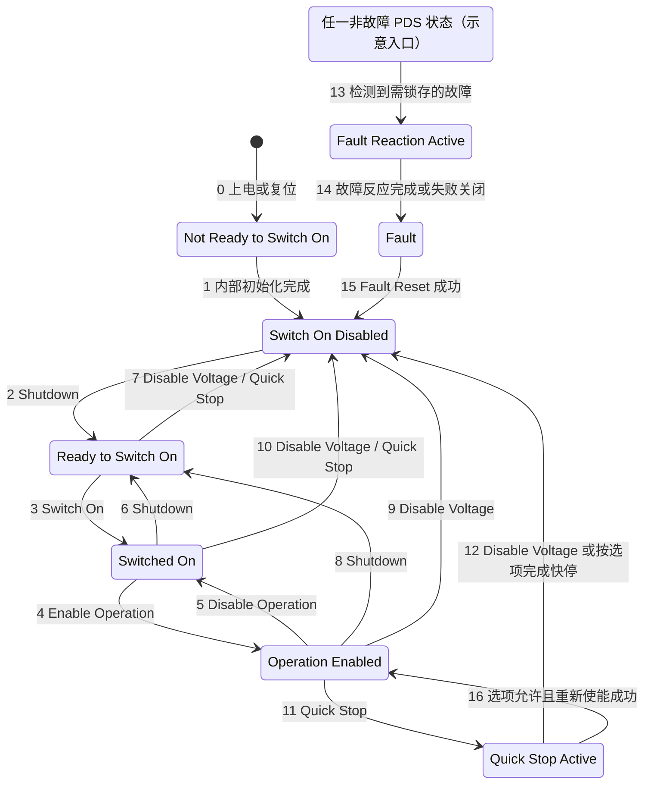

# DS 402 (CiA 402) 驱动 Profile 需求与开发指南

> 适用范围：当前仓库 CANopenNode 核心，以及 `xnet_intergration/` NI-XNET CANopen 从站集成。
> 参考资料：`reference/canopennode-rtt`（Pure-C CiA 402 Device 核心 + RT-Thread 适配）、`reference/EtherCAT_Slave`（EtherCAT 侧 CiA 402 示例应用）。
> 本文是后续开发的需求基线。首期范围已确定为 PP 位置控制；仅将仍需负责人决策的事项标注为 **[待确认]**。
> 实现进度：单轴 PP 的 internal 路径及 external motor_drive_ 私有邮箱已接入 CANopenNode worker；原本地交换 OD 已移除。JSON 启动校验、反馈提交、epoch/序号/超时与异步动作确认已有实现和 fake-XNET 覆盖。本文其余硬件语义、诊断覆盖和实物验收仍需逐项验证；功能验证不构成硬实时或安全认证。
> 后续系统基线：机器人 ECU 是唯一 CANopen Master/SYNC Producer；每个异步 CD/slave 独占一个 NI-XNET CAN 端口，各端口连接同一物理总线，每节点对应一个 PCL 固定步长模型。已实现设备适配、`motor_drive_` 异步 SI 接口及逐帧 SYNC 接收观察；SYNC 控制流水线和 VeriStand signal 桥接仍待实现。私有 counts v1 类型不自动具备新增同步语义。

---

## 1. 背景与目标

### 1.1 现状

- 当前 CANopenNode（根 `README.md`）是 ANSI C、MISRA C:2012 风格的协议栈，分层为 `301/`、`303/`、`304/`、`305/`、`309/`、`storage/`、`extra/`，**不包含** CiA 402 实现。
- `xnet_intergration/` 把 CANopen 从站通过 NI-XNET 暴露给 VeriStand 模型。当前已增加显式 JSON 启用的单轴 PP internal/external 路径；普通配置仍只做通信与 OD 存储。NMT 状态、CANopen 状态、DS402 驱动状态仍是三个独立概念。
  - `include/xnet_canopen.h` 说明库可按 JSON 显式启用 DS402 PP；未新增公共 ABI。
  - `src/model.cpp` 对启用配置校验必需对象、权限、类型和已启用 PDO 映射；不自动补建对象。
  - external 通过 motor_drive_ SI 接口与私有邮箱接入，不经过本地 OD API；模型仍由宿主应用运行，不由库隐式创建线程或模型实例。
  - `xnet_intergration/tests/app/README.md:113` 说明测试应用不实现 CiA 402。
- 设备 OD 由 JSON 配置描述；JSON 由工具从目标真实驱动设备的 EDS 转换生成。普通 CANopen 设备配置可以不包含 CiA 402 对象，电机驱动设备配置则包含其实际提供的 402 对象与 PDO 配置。
- 仓库已有 Kinco FD124 的 EDS（`xnet_intergration/eds/Kinco_FD_20250417_V1.2.eds`）与 JSON 配置样例（`examples/kinco_FD124.json`、`tests/app/kinco_FD124.config.json`）。

#### 1.1.1 最终 HIL 系统边界（已确定，待实现/部署验证）

- 机器人 ECU 负责运动控制、主站命令和 SYNC 产生；CD 中的 slave 只消费 SYNC，不另建竞争的 SYNC Producer。ECU 发起的多轴运动协调不表示当前 PP 核心自动提供三轴插补或同时到位。
- VeriStand Engine 提供 HIL 执行环境与 PCL。异步 CD 创建/复制配置并实例化 slave；每实例拥有独立 Node-ID、OD、PDS、模型端口、诊断与复位代次。复制配置不得共享可变 OD/模型存储；同总线 Node-ID 必须唯一。
- 一个 slave 对应一个 VeriStand 电机驱动模型，通过 signal 交互。模型由 PCL 按已配置固定步长调度，不由 CANopen 库创建线程，也不因 SYNC 到达而额外调用模型 step。实例之间不要求组级反馈提交、共同确认或阻塞屏障。
- CANopen/SYNC 域与 PCL 域异步运行。采用 §7.5.11 的时间标识、截止时间选样及有界缓冲，建立可检测违约的数据流水线；没有时钟映射与延迟预算验证时，不宣称逐 SYNC 的三轴模型同步或固定一周期反馈。
- 每个 xnet 句柄独占一个 NI-XNET 接口和会话；多个端口连接同一物理 CAN 总线，不共享会话或总线所有者。各端口独立接收 SYNC，局部接收序号不能直接跨端口比较；需验证共同 counter 或时钟关联、拓扑与硬件时间域。

### 1.2 目标

在不破坏 xnet 通信边界的前提下，提供一个**可复用、与硬件解耦**的 CiA 402 PDS（Power Drive System）状态机与模式处理模块，使上层（xnet 模型层或应用）只需实现驱动回调即可获得标准的 Controlword/Statusword 行为，并满足以下目标：

1. 按 IEC 61800-7-201 / CiA 402 规定实现 PDS 状态机、Controlword 解析、Statusword 生成。
2. 每个 slave 仅支持单轴电机驱动，使用设备 JSON/EDS 中该轴的标准 OD 索引；允许多个 CD/slave/模型实例模拟多个节点。单节点多轴及 `logicalDevice` 偏移属于未来扩展。
3. 首期只支持 PP（Profile Position）位置控制。PV、PT、HM、CSP、CSV、CST 等模式作为未来扩展，不属于本次实现与验收范围。
4. 驱动动作通过回调（DriveIF）抽象，核心模块不包含任何硬件或 CAN 代码。
5. 保留现有 C++ 核心和对外 C ABI，核心不依赖 OD/CAN；驱动动作非阻塞。实时部署能力需单独验证。
6. 与 xnet 的 OD 访问、批量 API、复位语义（Reset Node / Reset Communication）保持一致。

### 1.3 非目标

- 不实现厂商私有对象（如 Kinco 的 0x2FF0 系列），仅预留扩展点。
- 不实现通用运动规划器；首期 PP 的 profile/斜坡处理由核心负责，模型只实现位置跟踪、限幅和动态响应，不重复生成轨迹。
- 不修改 `xnet_canopen.h` 已发布的 ABI，除非另行批准（见 §9 第 3 项）。
- 不替代 EtherCAT 侧的 `cia402appl.c`，两者仅作为行为参考。

---

## 2. 参考实现对比

| 维度 | canopennode-rtt `profile/cia402` | EtherCAT_Slave `cia402appl.c` | xnet_intergration（当前） |
|---|---|---|---|
| 定位 | 独立 Pure-C 设备核心，RT-Thread 适配 | 示例应用，嵌入 EtherCAT 从站状态机 | 通信栈 + 外部电机驱动模型（Slave 侧），不解释 402 |
| 状态机入口 | `CO_402_device_axisProcess()`（`device/CO_402_device_fsa.h`） | `CiA402_StateMachine()`（`cia402appl.c:317`） | 无 |
| Controlword 来源 | OD 0x6040 绑定到 `objControlWord`，经 PDS 逐步处理 | OD 0x6040 映射到 `objControlWord`（`cia402appl.c:202`） | 无 |
| Statusword 生成 | 核心按 PDS 状态生成 | `StatusWord &= ~(STATUSWORD_STATE_MASK|REMOTE)` 后按状态或位设置（`cia402appl.c:333-336`） | 无 |
| 驱动动作 | `CO_402_drive_t` 回调 | `CiA402_DummyMotionControl()`（`cia402appl.c:567`） | 无 |
| 安全所有权 | QuickStop、DisableVoltage、FaultReaction 可抢占 BUSY 动作 | 无显式所有权模型 | 无 |
| 故障复位 | 0x6040 bit7 上升沿（edge-triggered） | 固定掩码 `CONTROLWORD_COMMAND_FAULTRESET_MASK`（`cia402appl.h:57`） | 无 |
| 多轴 | 参考实现支持，OD 基址 `0x6000 + n*0x0800` | 参考示例支持（`LocalAxes[]`） | 当前范围为单轴 |
| 模式 | 首期仅 PP（1） | 0x6502 存在时校验 PP 位，PDO 按 JSON 校验 | 无 |
| 堆使用 | 无堆，应用持有所有存储 | 静态 | 有 C++ 动态对象 |

**结论**：canopennode-rtt 提供了清晰的回调和安全所有权参考；当前按已确认决策保留仓库中的 C++ 核心，不重写为 Pure C。EtherCAT 示例的状态转换表可用于交叉核对。

---

## 3. 术语与状态

### 3.1 三个独立状态（必须区分）

1. **运行时状态**：`xnet_canopen_status_t.runtime_state`（UNINITIALIZED / STOPPED / RUNNING / FAILED）。
2. **CANopen NMT 状态**：`nmt_state`。
3. **CiA 402 PDS 状态**：本模块维护，通过 Statusword bit0-3、5、6 表示。

CANopen NMT 是底层通信层状态机，DS402 PDS 是上层电机控制状态机。NMT 状态本身不直接改变 PDS；DS402 可以读取 NMT 状态作为自己的输入，并由 DS402 决定电机控制动作、PDS 转换及相应 OD 发布（见 §6.4）。

### 3.2 DS 402 (CiA 402) PDS 状态机

#### 3.2.1 状态转换示意图

图中编号为 CiA 402 转换编号；命令来自 `0x6040`（Controlword），状态由核心通过 `0x6041`（Statusword）发布。图展示协议路径，外部模型的握手和完成条件见 §3.2.3；不能把一次 Controlword 写入视为状态已经转换。



- 常用命令示例（其余位为 0）：`0x0006` Shutdown、`0x0007` Switch On / Disable Operation（取决于当前状态）、`0x000F` Enable Operation、`0x0002` Quick Stop、`0x0000` Disable Voltage。由 `READY_TO_SWITCH_ON` 写 `0x000F` 可请求连续使能，但仍须先完成 Switch On，再执行 Enable Operation，不能跳过 `SWITCHED_ON`。
- 快停路径由 `0x605A` 决定：选项 `0` 在快停动作完成后进入 `SWITCH_ON_DISABLED`；选项 `1/2` 减速完成后退出至 `SWITCH_ON_DISABLED`；选项 `5/6` 停止后保持 `QUICK_STOP_ACTIVE`。设计要求重新使能同时满足有效反馈确认快停完成、选项允许和有效 Enable Operation 命令，不能只看 bit2 恢复（FR-PDS-07）。
- 外部模型快停必须有匹配的动作完成响应和有效的零速反馈；`0x605A` 支持 `0/1/2/5/6`，`0x605E` 支持 `0/1/2`。未配置时分别使用 `2`、`0`。

#### 3.2.2 八种状态与 Statusword

下表为本项目发布的状态位参考值（`0x6041 & 0x006F`），不是完整 Statusword。PP 相关位和其他状态位另按 §6.2 更新。

| PDS 状态 | 状态位 | 含义 |
|---|---|---|
| `NOT_READY_TO_SWITCH_ON` | `0x0000` | PDS 正在初始化或自检，不接受普通使能命令。 |
| `SWITCH_ON_DISABLED` | `0x0040` | PDS 已完成内部初始化，但尚未进入上电序列；不允许普通运动。等待 Shutdown。 |
| `READY_TO_SWITCH_ON` | `0x0021` | Shutdown 已完成，可接受 Switch On；尚未使能运行。 |
| `SWITCHED_ON` | `0x0023` | Switch On 已完成，但普通运动仍未获许可；等待 Enable Operation 及模型就绪确认。 |
| `OPERATION_ENABLED` | `0x0027` | Enable Operation 已完成。仅在普通输出许可有效时执行 PP demand；不代表电机正在移动或目标已到达。 |
| `QUICK_STOP_ACTIVE` | `0x0007` | 普通运动许可已撤销，按快停选项减速或保持停止；该状态本身不证明电机已经停稳。 |
| `FAULT_REACTION_ACTIVE` | `0x000F` | 故障已锁存，普通运动许可已撤销；正在请求和等待故障反应。 |
| `FAULT` | `0x0008` | 故障反应结束，或无法确认而已失败关闭；故障保持锁存，等待符合条件的主站复位。 |

#### 3.2.3 外部电机驱动模型与 PDS 的对应关系

模型状态是 PDS 的输入，不是独立的 CANopen 状态，也不能直接写 `0x6041`。PDS 核心结合主站命令、NMT 许可、模型反馈和动作结果决定对外状态。

| 外部模型或握手情况 | PDS 状态与处理 |
|---|---|
| 模型未启动、初始化中，或尚无本 epoch 的有效心跳和完整反馈；未超过 `startup_timeout_us` | PDS 本地初始化期间为 `NOT_READY_TO_SWITCH_ON`；本地初始化完成后自动进入 `SWITCH_ON_DISABLED`，不等待模型就绪。未获得匹配的动作确认不得推进对应转换，模型未就绪不得进入 `OPERATION_ENABLED`。 |
| 模型初始化异常 | 收到有效的模型故障报告，或等待有效心跳和完整反馈超时，即进入 `FAULT_REACTION_ACTIVE`，随后进入 `FAULT`。只是暂未就绪且未超时，不等同于故障；无反馈时不自动切换到 InternalModel。 |
| 模型初始化成功，心跳和完整反馈有效，处于待机 | 不自动使能。未收到主站命令时保持 `SWITCH_ON_DISABLED`；按 Shutdown、Switch On 及其匹配的 `DONE` 确认依次进入 `READY_TO_SWITCH_ON`、`SWITCHED_ON`。 |
| 主站请求使能，模型正在切换到控制运行 | 满足 NMT 和模型 PP 就绪条件才发出 Enable Operation。等待期间（含 `BUSY`）保持 `SWITCHED_ON`；只有收到同 epoch、同 `action_seq` 的有效 `DONE` 才发布 `OPERATION_ENABLED`。模型开始计算、仅有心跳或上报 `BUSY` 均不能替代确认。 |
| 模型正在控制，主站请求快停或撤销使能 | 先撤销普通输出许可，再按相应动作及完成条件发布目标 PDS 状态。外部模型异步执行期间，转换尚未提交时 `0x6041` 仍可能显示原状态；不能把该状态解读为仍允许普通运动。 |
| 控制中检测到模型故障、心跳或反馈超时、动作 `ERROR` 或超时 | 立即撤销普通输出许可，抢占未完成的普通动作并进入 `FAULT_REACTION_ACTIVE`。匹配的 Fault Reaction `DONE` 后进入 `FAULT`；若故障反应本身 `ERROR` 或超时，也进入 `FAULT`，但明确诊断停止未确认，不伪造 `DONE` 或用陈旧反馈证明停稳。 |
| 已进入 `FAULT` 后，模型恢复健康或重新开始报告有效数据 | PDS 保持 `FAULT`。当前故障条件清除、心跳及完整反馈有效且模型允许复位后，仍须主站在 `FAULT` 中发送新的 `0x6040` bit7 上升沿，并等待匹配的 Fault Reset `DONE`，才回到 `SWITCH_ON_DISABLED`。再次运行须重新走主站使能序列。 |

启动与运行监控见 §7.5.6，异步动作与失败关闭见 §7.5.4，故障复位见 §6.3 和 §7.8。源码参考：[PDS 核心](../402/drive402.cpp)、[设备侧看门狗与反馈处理](../xnet_intergration/src/device.cpp)。

---

## 4. 功能需求（FR）

每条需求给出验收标准。编号用于测试追溯。

### 4.1 OD 与对象

| ID | 需求 | 验收标准 |
|---|---|---|
| FR-OD-01 | 配置启用 `drive_402` 时，核心对象为 0x6040、0x6041、0x6060、0x6061；当前 PP 运行还依赖 0x6064、0x607A、0x6081、0x6083、0x6084。0x603F、0x6502、0x6085 等为可选对象。 | 初始化校验必需对象的类型、子索引、长度、访问属性；可选对象存在时也校验。PDO 映射不强制，已有映射须与 JSON/EDS 中的方向、对象和长度一致；未映射对象可通过 SDO 访问。必需项缺失或配置冲突时返回 `XNET_CO_MODEL_ERROR`。 |
| FR-OD-02 | 每节点仅支持单轴，使用 JSON/EDS 标准对象索引，不做轴偏移；多个节点通过独立实例实现 | 单节点多轴配置拒绝初始化；至少三个唯一 Node-ID 的单轴实例分别绑定独立模型，节点复位/反馈不污染其他实例 |
| FR-OD-03 | 核心不得假定对象有符号语义；符号/无符号由 OD/EDS 决定 | 0x6060 为 INTEGER8，0x6061 为 INTEGER8，读写不做错误的符号扩展 |
| FR-OD-04 | 对象访问须经过 OD 锁（与 xnet 的批量 API 锁序一致，见 §8.2） | 通过 SDO 写 0x6040 与批量写 API 并发时无数据竞争 |
| FR-OD-05 | 主站独占写入 target 与 profile 参数，核心独占决定 demand、状态和已接受实际值；设备适配层执行 OD 读写，模型通过 motor_drive_ 接口提交 SI 反馈 | 覆盖命令、反馈的网络/本地权限及单位转换；模型不得直接写标准实际值或状态，核心与适配层不得覆盖 0x607A 或 PP profile 参数 |

JSON 是 OD 与 PDO 配置的唯一运行时来源，初始化阶段不根据 `drive_402` 自动补建对象，也不在运行时动态添加 PDO 映射。普通设备 JSON 未声明 `drive_402` 时按普通 CANopen 设备初始化，不执行 402 对象校验或状态机；声明启用时，若 EDS 转换得到的 JSON 缺少当前 PP 实现必需的对象或其他必要配置，必须作为配置错误拒绝初始化，不得静默降级为普通设备或自动补默认对象。0x603F 不存在时不发布该对象，但 external 故障仍通过状态机和 EMCY 处理。external 模型必须显式提供 device_adapter（含有效 counts_per_revolution），通过 motor_drive_ 私有邮箱交换；邮箱不是 OD，不要求或自动创建本地交换对象。

**实现说明**：`canopennode-rtt` 的 OD 扩展通过 `CO_402_device_bindOD()` 绑定，并在 Communication Reset 时重新绑定（见 `docs/en/cia402-device-rtt.md`）。xnet 中对应的是 `Model` 的 `resolve_node` / `configure` 流程（`xnet_intergration/src/model.cpp:427`、`:494`），绑定点应放在同一流程里。

### 4.2 PDS 状态机

| ID | 需求 | 验收标准 |
|---|---|---|
| FR-PDS-01 | 按 CiA 402 状态转换表实现 PDS，普通转换由 Controlword 发起，内部就绪、故障及驱动完成条件由核心处理 | 单元测试覆盖全部合法转换（至少 1–15 号转换）、异步完成及非法转换忽略 |
| FR-PDS-02 | Statusword 由 PDS 状态派生，bit0-3、5、6 与状态一一对应 | 每个状态下 Statusword 的状态掩码 `0x006F` 与参考值一致（见 `cia402appl.h:90-97`） |
| FR-PDS-03 | 冷启动、Stop → Start 和成功的 NMT Reset 均从 `NOT_READY_TO_SWITCH_ON` 开始，OD 绑定后发布初始 `0x6041/0x6061`。本地初始化完成后由监督周期自动转换到 `SWITCH_ON_DISABLED`，不依赖 Controlword、NMT Operational、SYNC 或外部模型就绪。 | 在受控周期验证 `0x6041 & 0x006F` 依次为 `0x0000`、`0x0040`，且转换 1 不同时执行 Shutdown。Boot-up 帧不是 Statusword；主站第一次 SDO 可已读到 `0x0040`，不要求用 TPDO 捕获瞬态。 |
| FR-PDS-04 | Controlword 0x000F 视为 Switch On + Enable Operation 的单条命令，但仍按状态逐步处理，不得跳过 `SWITCHED_ON` 的驱动回调 | 由 `READY_TO_SWITCH_ON` 直接写 0x000F，回调顺序为 switchOn → enableOperation |
| FR-PDS-05 | 驱动动作必须非阻塞，返回 BUSY / DONE / ERROR，核心据此推进 | 回调 BUSY 时状态保持，DONE 后提交新状态 |
| FR-PDS-06 | Shutdown、Disable Voltage、Quick Stop 必须按 CiA 402 规定的优先级生效 | Quick Stop 可抢占 BUSY 的 enableOperation；Disable Voltage 可抢占任何 BUSY |
| FR-PDS-07 | Quick Stop Active 的完成与退出同时考虑 0x605A、有效反馈和 Controlword，不得仅以 bit2 恢复判定重新使能 | 覆盖支持的选项码、减速未完成、命令撤销与重新使能路径 |

### 4.3 Controlword / Statusword 位定义

| ID | 需求 |
|---|---|
| FR-CW-01 | Controlword 位 0–3、7 参与 PDS 命令；位 4–6、8 作为模式相关位（set-point、change immediately、relative、halt） |
| FR-CW-02 | 故障复位为边沿触发：仅在 FAULT 状态下 bit7 由 0 变 1 时生效（canopennode-rtt 行为） |
| FR-CW-03 | 不得把 Statusword 的保留位置为非零值；bit11（internal limit）与 bit12（模式相关）仅由对应模式写入 |
| FR-CW-04 | 首期 PP 的 Statusword bit10（target reached）、bit12（set-point acknowledge）及 bit11（internal limit）由 PP 模式逻辑维护；其他模式相关位不在首期实现范围 |

### 4.4 模式

| ID | 需求 |
|---|---|
| FR-MODE-01 | 首期只启用 PP（模式值 1）；其他模式的运行逻辑不属于首期 |
| FR-MODE-02 | 0x6502 可缺省；存在时须包含 PP 能力（bit0），允许保留源设备声明的其他位。其他位不表示模拟器支持这些模式。 |
| FR-MODE-03 | 0x6060 写入 1 表示 PP；写入任何其他模式值必须拒绝（SDO Abort 或返回错误），不得改变当前模式；0x6061 仅在 PP 初始化/就绪后发布 1 |
| FR-MODE-04 | 首期不支持运行时模式切换；0x6060 不得从 PP 切换到其他模式。该能力作为未来需求另行设计 |
| FR-MODE-05 | PP profile 位置命令按 Controlword 的 new-set-point、change-immediately、relative 等相关位处理，并由核心生成 profile demand；同一命令不得重复触发，确认及 target reached 判据必须有单元测试 |

### 4.5 DriveIF（驱动回调）

| ID | 需求 |
|---|---|
| FR-DRV-01 | 必须提供以下回调：`shutdown`、`switchOn`、`enableOperation`、`disableOperation`、`quickStop`、`faultReaction`、`faultReset`、`disableVoltage`；动作请求及结果枚举与之对应并在协议冻结时明确 |
| FR-DRV-02 | 回调返回值为 `CO_402_drive_result_t`（BUSY/DONE/ERROR） |
| FR-DRV-03 | 安全相关回调（quickStop、disableVoltage、faultReaction）可以抢占 BUSY 的普通动作；同步撤销旧动作的逻辑输出权限，异步模型按新 action_seq 执行安全反应；不承诺跨线程同步撤销物理效果（§7.5.4） |
| FR-DRV-04 | 所有回调禁止阻塞、禁止调用 CAN/OD 访问函数、禁止在回调中获取 OD 锁 |
| FR-DRV-05 | 外部模型通过带代次和动作序号的反馈确认 BUSY/DONE/ERROR；回调只发布动作或检查缓存响应，不执行模型计算、不等待 PCL/模型 |

### 4.6 故障与复位

| ID | 需求 |
|---|---|
| FR-FLT-01 | 任何内部故障（PDS 操作失败、Controlword 读取失败、产品故障）都进入 `FAULT_REACTION_ACTIVE`，再进入 `FAULT` |
| FR-FLT-02 | 故障源必须被锁存并通过诊断接口（DiagIF）暴露，缺失映射时仍按失败关闭（fail-closed） |
| FR-FLT-03 | 0x603F 反映当前故障周期首次锁存的故障代码，直到成功故障复位；后续故障独立报告 EMCY |
| FR-FLT-04 | Reset Node 恢复普通应用 OD 默认值；Reset Communication 保留普通应用 OD 并重新绑定扩展；两者均使模型交换会话失效，更新 epoch，不复用旧动作/反馈（§7.5.7） |
| FR-FLT-05 | Reset Communication 期间，若驱动处于 OPERATION_ENABLED，必须先经过 quickStop 或 faultReaction，不得直接丢弃 |
| FR-FLT-06 | 区分当前故障条件、锁存记录与复位许可；仅在条件清除、模型健康且有匹配完成响应后允许复位，FAULT 中仍持续反馈与心跳 |

### 4.7 运行与集成

| ID | 需求 |
|---|---|
| FR-RUN-01 | 提供周期入口 `CO_402_device_axisProcess()`，建议周期 1–10 ms，由调用方决定 |
| FR-RUN-02 | 每节点 402 仅由通信域的单一执行者处理；VeriStand 模型由 PCL 固定步长调度，异步 CD 只桥接 signal，不能再次调用模型 step 或 axisProcess |
| FR-RUN-03 | 诊断与日志通过 `CO_402_LOG_*` 宏输出，允许通过 `CO_402_LOG_CUSTOM_HEADER` 覆盖 |
| FR-RUN-04 | Demo 模式只做软件仿真，不得驱动硬件 |
| FR-RUN-05 | CANopen 后端/CD 与 PCL 异步；一个节点一个模型，独立交换，无组级提交；模型计算在库锁外，核心只消费完整且身份/年龄有效的反馈 |
| FR-RUN-06 | 心跳新鲜度和反馈新鲜度独立监测，以本机单调时钟的实际经过时间判超时；不得用名义 worker 周期数替代时间 |
| FR-RUN-07 | 在显式启用的 SYNC 控制方案中，正常命令锁存/profile 更新按 ECU SYNC 边界；默认模式遵循 PDO 的同步或异步配置，协议和安全看门狗仍持续运行 |
| FR-RUN-08 | signal 交换关联 SYNC 周期、PCL/model 步及采样时间；按配置截止时间和有界历史选样，不将最新到达值无条件标为当前周期 |

---

## 5. 非功能需求（NFR）

| ID | 需求 | 验证方式 |
|---|---|---|
| NFR-01 | 维持现有 C++ 核心，不依赖 OD/CAN；对外提供 C ABI | 代码审查与 C ABI 测试 |
| NFR-02 | 与现有 xnet 代码风格一致（xnet 为 C++ 实现，对外 C ABI） | 代码审查 |
| NFR-03 | MISRA C:2012 风格（参照根 README）；允许偏离需在注释中说明 | 静态检查 |
| NFR-04 | 首期以 CANopen 毫秒级功能验证为目标，不宣称硬实时 WCET/安全认证；启用确定流水线时必须配置并验证时钟误差与路径延迟预算，超预算显式违约，不能用功能通过替代实时证明 | 功能测试、流水线预算验证及违约注入 |
| NFR-05 | 不得在 `xnet_canopen.h` 已有函数的签名或语义上做破坏性修改 | ABI 对比 |
| NFR-06 | 所有新文件包含版权与模块说明头，与 `CO_402_*` 风格一致 | 代码审查 |
| NFR-07 | 只在需要注释处添加注释（仓库约定） | 代码审查 |
| NFR-08 | 可记录模型周期、批量 API 持锁时间、worker 周期、反馈年龄与命令到反馈/TPDO 延迟，供功能调试使用；这些观测值不是首期性能通过/失败门槛 | 功能测试中的诊断记录 |

---

## 6. 行为规范（实现约束）

### 6.1 Controlword 处理顺序

1. 在 worker 锁内读取 Controlword、模式和 target 快照，并消费通过代次校验的完整模型反馈。
2. 若读取失败，调用 `CO_402_device_axisControlwordReadFailed()`，进入 FAULT 路径。
3. 判定 Quick Stop / Disable Voltage 等安全命令是否优先。
4. 按当前 PDS 状态处理普通命令。
5. 更新 Statusword，写入 0x6041。

### 6.2 Statusword 派生

Statusword 的状态位由 PDS 当前状态决定，PP 相关位由核心根据已接受反馈维护；模型不直接写 Statusword。bit10 的位置容差/持续时间、bit11 的限幅来源及 bit12 的 set-point acknowledge 判据须写入配置和测试。实际反馈无效或过期时，不得报告新的 target reached。Statusword 与实际值应在 OD 锁内发布，避免 TPDO 读到未提交反馈。

### 6.3 Fault Reset

- 只在 FAULT 状态且 bit7 上升沿时调用 `faultReset`。
- 连续保持 bit7=1 不得重复触发。
- 当前故障条件清除、模型心跳和完整反馈均有效、模型允许复位后，才可启动 faultReset 动作；匹配的 DONE 返回后回到 `SWITCH_ON_DISABLED`。
- 条件不满足则拒绝本次请求并诊断，不排队保留边沿。主站须在条件满足后重新发送可被采样的 0→1 脉冲；FAULT_REACTION_ACTIVE 中的提前边沿不得延迟执行。

### 6.4 NMT 与 PDS 的关系

- NMT 状态机只管理底层 CANopen 通信状态；NMT 状态变化不直接调用或改写 PDS 状态，也不直接触发电机控制动作。
- DS402 周期逻辑可以读取 NMT 状态，并据此决定自身是否接受普通控制命令、撤销输出许可、执行 disableVoltage/quickStop 等动作，以及如何更新 PDS 和 0x6041。所有电机控制行为变化必须经 DS402 状态机完成并由其发布相应 OD。
- NMT 状态到 DS402 行为的具体策略属于 DS402 产品策略，须在 DS402 内定义并测试；NMT 重新进入 Operational 不得自动恢复 `OPERATION_ENABLED`，需要重新满足 DS402 条件并由主站发送使能命令序列。
- worker 逐帧交付离开 Operational 的事件，不等待下一次 SYNC；即使 Stop 和 Start 同批到达，PDS 也会撤销原输出许可。返回 Operational 后必须重新写入 `0x6040`，不能沿用退出前的使能命令。
- 外部模型停机未确认时，Stop 清理完成后返回错误；Reset Node / Reset Communication 不重建栈，也不递增完成计数。等待期间现有模型端口仍可回传停止动作结果。

---

## 7. 推荐架构

### 7.1 分层

```
机器人 ECU（Master / SYNC Producer）→ CANopenNode / OD
                        │
        xnet_intergration/src/ OD 适配层
                        │ 结构化输入输出
                 402/ 独立逻辑核心
                        │ 动作、模式、demand / 已提交反馈
        xnet_intergration/src/ 模型交换适配层
                        │ motor_drive_ SI 接口（设备私有邮箱）
        异步 VeriStand CD（时间标识、缓冲、signal 桥接）
                        │ VeriStand signal
        每节点独立驱动模型（VeriStand PCL 固定步长）
```

### 7.2 复用策略 **[待确认 — 需负责人决策]**

| 方案 | 做法 | 优点 | 缺点 |
|---|---|---|---|
| A. 直接引入 | 把 `reference/canopennode-rtt/profile/cia402/{common,device}` 的独立逻辑移植到 `402/`，OD/平台代码留在适配层 | 可复用现有行为与测试 | 需确认许可证、去除 RT-Thread 依赖，并验证锁与异步模型契约 |
| B. 仅移植行为 | 以 canopennode-rtt 为行为规范，重新实现 Pure-C 核心 | 许可与依赖清晰 | 工作量大，需重新验证 |
| C. 只在模型层实现 | 在 `model.cpp` 中实现 402 解释器 | 改动小 | 违背 xnet 通信边界声明；难以复用到其他平台 |

**推荐方案 A（若许可证允许）或 B**。不推荐 C，因为它直接违背 `xnet_canopen.h` 的声明，并使模型层承担状态机逻辑。

### 7.3 与 xnet 集成点

1. **OD 来源与校验**：启动时加载 JSON；该 JSON 由设备 EDS 转换工具生成并决定 OD 与 PDO，不由 402 核心补建对象。未声明 `drive_402` 时按普通设备初始化；声明启用时，校验 PP 必需对象、存在的可选对象及配置中的 PDO 映射；不强制指定 PDO 映射，必需对象缺失或配置不匹配时拒绝启动。
2. **绑定（当前实现）**：`Model::load()` 完成 PP 必需 OD 与已配置 PDO 校验；显式启用时由 `device.cpp` 在 `setup_stack()` 安装 0x6060 SDO 写扩展，拒绝非 PP 模式。当前是 C++ `Drive` 直接读写已校验 OD，尚无通用 `CO_402_device_bindOD()` API。
3. **周期调用**：402 默认 worker 对同批接收的每个 SYNC 依次应用同步 RPDO、处理 402 状态并生成符合 transmission type 的 TPDO；普通 301 设备保持原来的批次接收后统一处理 PDO。402 实际经过时间和协议定时仍按 worker 时间推进，异步 PDO 不等待 SYNC。定时测试路径才按映射后的边界间隔推进正常 profile。每节点核心只能有一个执行者；模型只由 VeriStand PCL 调度，不在 worker/CD 内计算。
4. **Reset**：Reset Node/Communication 与 worker stop 在重建或退出前请求 DS402 安全动作；external 路径等待匹配动作反馈，并通过新 epoch 使旧帧失效。NMT 层不直接修改 PDS。
5. **状态快照**：保持已发布 `xnet_canopen_status_t` ABI；402 设备状态可通过版本化系统快照及配置已有的只读 OD 对象观察，时间/模型步与处理确认通过 motor_drive_ 快照及 CD 诊断 signal 提供，不自动新增设备 OD。复位代次随模型命令快照发布。

**系统查询补充**：`xnet_canopen_get_system_status_v1` 在同一运行时锁中返回原通信状态和
可用时的 PDS、状态字、动作及模型状态标志；`drive_valid` 标识驱动字段是否存在，停止或
失败后的数据可能是历史快照。`xnet_canopen_get_capabilities_v1` 报告已初始化配置及
实际实现能力（目前仅 PP、外部模型异步/启动/安全读取），不把 EDS 的模式声明或测试定时
路径视作生产能力。`xnet_canopen_get_diagnostic_v1` 提供同一设备最新诊断的来源域、
来源码、旧 XNET 码与消息；模型错误保留 `MOTOR_DRIVE_*` 结果，但诊断不与单次调用
关联，未关联有效设备的错误无法记录。查询均使用固定 v1 布局和容量参数；旧 301 API、
模型邮箱和停止握手语义不变。详见 [接口说明](../xnet_intergration/README.zh-CN.md#版本化系统查询)。

**系统设备 facade**：`co_device.h` 为单个仿真从站提供独立的设备句柄、生命周期、
系统查询及高级 OD/batch 操作。旧句柄可通过 `co_device_open_motor_port_from_xnet`
在同一设备上打开端口，无需创建第二个后端；版本化查询等扩展声明位于
`xnet_canopen_extensions.h`。`co_device_open_motor_port` 在同一个后端锁域内打开
唯一模型端口，无需宿主管理借用的 endpoint；已占用时返回 `CO_DEVICE_BUSY`，详情可从
统一诊断获取。模型仍使用 `motor_drive_` 交换，端口由调用方关闭。`co_device_stop`
仍是阻塞式握手，停止期间模型交换必须保持；它不是非阻塞停止接口，也不改变部署时序
能力。详见 [facade 说明](../xnet_intergration/README.zh-CN.md#系统设备-facade)。

### 7.4 DriveIF 对 Kinco FD124 的适配 **[待确认]**

- 需确认 FD124 的 0x6040/0x6041 行为是否与标准一致（尤其 bit4、bit5、bit8 的含义）。
- 需确认 FD124 EDS 中是否声明 0x6502、0x603F，以及它们的 PDO 映射属性。
- 需确认 FD124 的 quickStop 选项码（0x605A）与 shutdown 选项码（0x605B）默认值。

---

### 7.5 外部电机驱动模型接口

> 本节假定已有 **Slave 侧驱动行为模型**（下文简称“模型”），负责跟踪、动态响应、限幅及故障条件，可在其内部组合电机和负载模型。借鉴 Beckhoff Torque Controller 的强类型端口、固定步长、模式门控与诊断方式，不直接接入其主站控制逻辑。

**结论：外部模型业务接口采用 `motor_drive_` 前缀、SI 物理单位和不透明句柄，不暴露 XNET 类型、OD 地址、batch ID 或设备原始单位。** 设备适配层负责单位转换及设备端 OD 读取/发布；PDS 状态机与 Statusword 每节点只有一份，已有模型若包含 PDS，应拆出或关闭该部分。C 接口由异步 CD 调用，VeriStand 模型通过 signal 收发对应字段，计算只由 PCL 负责。

当前异步传输已采用 motor_drive_ 专用接口与设备私有邮箱，不经过 OD/batch，不改变已发布 xnet ABI。设备适配层在 SI 与核心 counts 之间转换。内部继续复用 CO_402_protocol 的类型与反馈校验编码，但这不是网络 OD 或外部模型的传输契约；SYNC/PCL 定时邮箱仍待实现。

#### 7.5.1 职责分工

| 角色 | 负责的数据/行为 | 访问通道 |
|---|---|---|
| 机器人 ECU | 运动命令、0x6040、0x6060（仅 PP）、0x607A/profile 参数与 SYNC | 唯一 Master/SYNC Producer，SDO/RPDO 按设备配置开放 |
| 402 核心 | PDS、Statusword、模式显示、锁存故障；PP profile demand 与实际值验收 | worker 内决定逻辑输出，不访问模型，不覆盖主站 target |
| 设备适配层 | OD index/subindex 绑定、手册单位与 SI/核心单位转换、设备故障映射；读取主站输入，发布核心输出及已接受实际值 | 设备端 OD 锁内读写；只执行映射与转换，不自行推进 PDS 或决定到位/故障复位 |
| 异步 CD / 模型交换适配层 | 每节点 motor_drive_ 端口、signal 映射、SYNC/PCL 身份与时间映射、有界缓冲和完整提交 | CD 调用专用邮箱 C 接口，signal 连接独立模型；不依赖 OD/batch，不阻塞 PCL 或执行模型计算 |
| VeriStand Engine / PCL | 模型调度、固定步长、signal 映射阶段及模型步身份 | 与 CAN 域异步运行，不由 SYNC 回调强行重入 |
| VeriStand 模型 | SI 实际值、动作结果、PP 就绪、限幅、通用当前故障条件与复位许可 | 每节点一个模型，通过 signal 回传完整步快照，不直接访问 OD/XNET 或生成 Statusword |

首期 PP profile/斜坡生成归核心，模型不得重复。PV、PT、HM、CSP、CSV、CST 等模式及相应 demand 处理均为未来扩展。

##### 7.5.1.1 motor_drive_ 业务接口与 SI 单位

通用类型、函数与常量分别使用 `motor_drive_` / `MOTOR_DRIVE_` 前缀；不得在公共参数、返回类型或结构体中引入 `xnet_canopen_handle`、OD index/subindex、batch ID 或厂商原始比例。CD 后端适配创建 endpoint 并打开独立节点端口，XNET 资源仅由后端持有；模型只连接 SI/身份 signal，不直接持有 C 句柄。

| 物理量 | 公共接口单位 | 字段后缀示例 |
|---|---|---|
| 直线位置、速度、加速度 | m、m/s、m/s² | _m、_m_s、_m_s2 |
| 角位置、角速度、角加速度 | rad、rad/s、rad/s² | _rad、_rad_s、_rad_s2 |
| 电流、电压 | A、V | _a、_v |
| 力、力矩 | N、N·m | _n、_nm |
| 物理时间、温度 | s、K | _s、_k |

首期 PP 是旋转电机轴端口，命令/反馈使用 rad 与 rad/s，安全减速度幅值使用 rad/s²。直线量、电流、力矩等表项是未来字段的单位规则，不表示首期新增这些遥测量或运行模式。未来直线轴须使用独立的 m/m/s 字段，不能将同一 _rad 字段重新解释为米；负载线速度与电机角速度之间的转换需要明确的机械传动参数。

SI 字段采用 `double`，字段名称携带单位，所有有效数值必须有限；NaN、Inf、非法负幅值及不可表示的 OD/核心转换值均明确拒绝。epoch、序号、枚举和位掩码不属于物理量，仍使用固定宽度整数；既有配置名中的 _us 与私有核心类型的 counts 单位保持不变。

以下接口已发布于 [motor_drive.h](../xnet_intergration/include/motor_drive.h)。动作编号为 0 none、1 shutdown、2 switchOn、3 enableOperation、4 disableOperation、5 quickStop、6 faultReaction、7 faultReset、8 disableVoltage，结果为 NONE/BUSY/DONE/ERROR；ABI 不直接存 C enum/bool。v1 大小已冻结：time=16、cycle=64、model_step=56、request=88、view=208、feedback=184 字节，C 测试检查布局；既有 xnet 状态与私有 counts 类型/反馈编码不变。

**当前实现边界**：READ_ASYNC/BOOTSTRAP/SAFETY 已实现，目标步/截止时间必须为 0；READ_SCHEDULED 明确返回 UNSUPPORTED，不执行下述未来定时选样。SYNC cycle/target_step 返回 0；publish_time 为进程 steady clock 秒、clock_domain_id=1，模型采样时间不自动映射至该域。反馈报告真实模型步、心跳验证执行进展；CD/signal 尚未实现。backend 用 xnet_canopen_get_motor_drive_endpoint 创建绑定，模型端头文件无 XNET/OD 类型。

```c
#include <stdint.h>

typedef struct motor_drive_endpoint* motor_drive_endpoint_handle;
typedef struct motor_drive_port* motor_drive_port_handle;

typedef struct {
    uint32_t clock_domain_id;
    uint32_t flags;
    double time_s;
} motor_drive_time_v1;

typedef struct {
    uint64_t sync_domain_id;
    uint64_t sync_domain_epoch;
    uint64_t sync_cycle_id;
    uint32_t sync_counter;
    uint32_t flags;
    motor_drive_time_v1 rx_time;
    motor_drive_time_v1 sync_time;
} motor_drive_cycle_v1;

typedef struct {
    uint64_t pcl_epoch;
    uint64_t pcl_tick;
    uint64_t model_step_seq;
    double model_time_s;
    double step_duration_s;
    motor_drive_time_v1 sample_time;
} motor_drive_model_step_v1;

typedef struct {
    uint64_t epoch;
    uint32_t command_seq;
    uint32_t action_seq;
} motor_drive_token_v1;

typedef struct {
    uint32_t abi_version;
    uint32_t struct_size;
    uint32_t flags;
    uint32_t reserved;
    motor_drive_model_step_v1 target_step;
    motor_drive_time_v1 source_cutoff;
} motor_drive_read_request_v1;

typedef struct {
    uint32_t abi_version;
    uint32_t struct_size;
    motor_drive_token_v1 token;
    motor_drive_cycle_v1 source_cycle;
    motor_drive_model_step_v1 target_step;
    motor_drive_time_v1 publish_time;
    uint32_t action;
    uint32_t flags;
    int32_t mode;
    uint32_t reserved;
    double demand_position_rad;
    double demand_velocity_rad_s;
    double safety_deceleration_rad_s2;
    uint32_t processed_feedback_seq;
    uint32_t processed_result;
} motor_drive_view_v1;

typedef struct {
    uint32_t abi_version;
    uint32_t struct_size;
    motor_drive_token_v1 source;
    motor_drive_cycle_v1 source_cycle;
    motor_drive_model_step_v1 executed_step;
    uint32_t feedback_seq;
    uint32_t action_result;
    uint32_t flags;
    uint32_t limit_flags;
    double actual_position_rad;
    double actual_velocity_rad_s;
    uint32_t fault_class;
    uint32_t fault_detail;
} motor_drive_feedback_v1;

int32_t motor_drive_open_v1(
    motor_drive_endpoint_handle endpoint, motor_drive_port_handle* port);
int32_t motor_drive_read_v1(
    motor_drive_port_handle port, const motor_drive_read_request_v1* request,
    motor_drive_view_v1* view, uint32_t capacity);
int32_t motor_drive_submit_v1(
    motor_drive_port_handle port, const motor_drive_feedback_v1* feedback,
    uint32_t size);
int32_t motor_drive_heartbeat_v1(
    motor_drive_port_handle port, const motor_drive_token_v1* source,
    const motor_drive_model_step_v1* progress, uint32_t heartbeat_seq);
int32_t motor_drive_close_v1(motor_drive_port_handle port);
```

- 命令 flags 表示普通运动输出许可、PP 就绪及 safety_deceleration 有效性；减速度有效时必须为正值，无效时模型只按动作定义执行，不能据 0 猜测设备比例。mode 首期仅 0（未就绪）或 1（PP）。最终 target、Controlword、Statusword 和 profile 参数只作独立诊断，不作为模型重复规划或解释 PDS 的执行输入。
- 反馈 flags 表示位置有效（必需）、速度有效、PP 就绪及复位许可；limit_flags 是模型限幅原因，由核心合成状态位。fault_class/detail 表示当前通用故障条件，0 类表示无当前故障；设备适配层按已验证的设备故障表映射非零码，缺失映射报错并按失败关闭处理，模型不携带 Kinco 私有故障表。
- time.flags 区分有效时间与硬件来源，clock_domain_id 标识时间原点/时基；不同时间域不能直接相减。cycle.flags 区分有效 SYNC 身份、有效 counter 与有效映射，rx_time 为硬件接收域时间，sync_time 为经验证映射后的桥接域时间。原始硬件 tick 另保留在后端诊断中，不能把主机出队时刻伪装为硬件接收时刻。
- source_cycle 来自通信后端，不能由模型自增或从 command_seq 猜测。模型只需回显源身份；CD 根据不可变历史补回 rx_time 等原始元数据，回显与记录不符拒绝，不能用 CD 当前时刻替换来源时间。target_step 是 CD 为固定流水线指定的执行步；executed_step 报告实际模型步，不能照抄未执行的目标步。pcl_epoch/pcl_tick 表示 Engine 时序身份，model_step_seq 表示该模型执行进展；model_time_s 是积分时间，不等同系统/硬件绝对时间。sample_time 只有取得真实 PCL 采样时刻并明确时基才有效。
- read 的 flags 显式区分定时正常快照、启动握手和优先安全快照。定时读取按 source_cutoff 从有界历史选取已完整发布的命令，返回同节点 epoch 的命令/确认和目标步；截止窗口未闭合、无候选或映射无效返回明确结果，不偷偷选择更新命令。启动/安全读取可无有效 SYNC 来源，但不得用于普通运动；安全快照在下一模型步生效，不等待失效的时间映射恢复。
- submit 全量校验/暂存，成功仅表示入邮箱或同内容幂等重试，最终接受/拒绝由 worker 发布到 processed_result（0 无结果、1 接受、2 命令过期、3 内容/周期无效）。每端口最多一个未确认反馈；确认属于 view.token.epoch，不跨代次复用。安全响应仍需当前 epoch/匹配 action_seq、真实模型步和本机提交期限，不因 SYNC 时间失效而无限等待。
- 业务 API 返回独立的 MOTOR_DRIVE_ 操作结果，区分无可用命令、未初始化/失效端口、邮箱占用、旧代次、非法反馈和后端错误；不直接暴露 XNET_CO_*。返回失败时输出快照不可使用，提交不得部分成功，后端异常须保留诊断。实现前冻结操作结果值、flags/limit_flags、故障类别、结构大小/对齐与生命周期契约，并为 C/LabVIEW 提供对应布局。
- open 建立唯一 signal 反馈写入者，通用 OD/batch 不再提供模型写入通道；heartbeat 只转发模型实际执行的 progress，旧节点/PCL 代次或重复模型步不得刷新存活时间，CD 自身循环不代表模型存活。端口在后端 uninitialize 后失效；节点 Reset/stop/start 更新节点 epoch，Engine 重部署更新 pcl_epoch，总线时基重建更新 sync_domain_epoch。各类代次独立，单节点复位不重置其他节点的模型状态。
- 停止握手时可用的 PCL/signal 交换必须保持到本节点停止完成；异步 CD 不在 PCL 内阻塞调用 stop。Engine 已停止模型执行时，使用有界失败关闭路径并报告停止未确认，不能等待下一 PCL 无限阻塞或伪造 DONE。独立线程 demo 仍按 stop → 模型退出/join → close/uninitialize 顺序处理；VeriStand 模型生命周期由 Engine 管理，不由库 join。

**设备适配层的 OD 读写与转换**

1. 绑定表关联通用角色与 OD，复用 EDS/JSON 类型/权限，补充单位、比例和坐标条件。缺少必需 OD、有效 counts/rev、非法比例或溢出拒绝；按本轮确认政策，未知单位先用 raw/core 1:1，告警并列入 assumed_identity，不能标为已验证，不在运行时补建对象。
2. 通信执行者在正常 SYNC 的 RPDO 边界读取设备 OD 原始命令/参数，适配层转换为核心单位；核心生成 profile demand，再转换为 SI 快照。既有核心及私有类型保留 counts 单位，不能把 Kinco 原始速度/加速度数值原样转发。
3. CD 转发 SI 反馈，适配层在暂存前校验可转换性；通信执行者再校验代次、年龄、动作与完整性。当前异步路径验收后直接发布实际值；新增流水线路径先保留已接受反馈历史，按 §7.5.11 截止选样，再按手册单位在同一 OD 锁内发布完整实际值集合。核心状态/安全处理仍由通信执行者决定，拒绝帧不污染值，API 提交本身不触发 TPDO 或推进 PDS。
4. 主站独占 target/profile；适配层不回写有损往返值。已绑定 demand/遥测可按已确认比例或已报告的 1:1 假设发布；未知缩放不擅自套用同名对象公式，也不能将直通假设说成单位已确认。批量读写、锁序与 Reset 后重绑遵守 §8。
5. 单位、编码器分辨率、方向、零点与机械换算在一次交换中必须一致；允许更换这些配置的后端须同时撤销旧 epoch 并重新握手，禁止把旧坐标下的计算结果按新比例发布。位置增量/相对命令不重复加零点，同一方向变换只应用一次。

当前通过 `drive_402.device_adapter` 初始化配置：unit_profile 为 counts、identity 或 kinco_fd，counts_per_revolution 必须显式提供，direction=±1、zero_counts 为固定坐标配置。scales 按角色设置正整数 numerator/denominator；fault_mapping 按通用 class/detail 映射非零设备码。当前绑定 607A、6081/83/84/85、6064 及可选 60FC/606B/606C；不自动读取 607E/607C/6410、脉冲齿轮比或 6067/6068/607D。修改配置需 uninitialize/initialize，旧端口不恢复可用。

**转换检查清单**：初始化日志与 xnet_canopen_get_drive_unit_report JSON 输出 converted、unchanged、assumed_identity、unbound，包括角色、OD、比例和依据。kinco_fd 已换算 6081/606C（×125/2048）、6083/6084（×15625/256）；607A 增量无需换算；6064/60FC 坐标、606B 速度、6085 减速度默认直通并待核对。缺失可选 OD 列为未绑定；原始单位直通不取消 counts↔SI 物理换算。配置/调用示例见 [英文说明](../xnet_intergration/README.md#device-units-and-motor_drive_-si-port) 与 [中文说明](../xnet_intergration/README.zh-CN.md#设备单位适配与-motor_drive_-si-接口)。

#### 7.5.2 专用模型邮箱（移除本地交换 OD）

**评估结论：当前异步单轴 PP 的功能已经由 motor_drive_ 接口覆盖，可以移除 0x2F00–0x2F05 本地交换对象。** 异步交换不依赖 SYNC/PCL 确定流水线；后者尚未实现，`READ_SCHEDULED` 返回 `MOTOR_DRIVE_UNSUPPORTED`，不伪造时钟或周期元数据。保留厂商 OD 并不能补齐这些能力。

| 原交换用途 | 当前替代机制 | 所有者 |
|---|---|---|
| 当前模型故障（原 0x2F00） | 反馈 fault_class/detail 经适配映射，worker 私有当前条件；首次故障仍锁存到可选标准 0x603F，并发送 EMCY | worker |
| 独立心跳（原 0x2F01） | motor_drive_heartbeat_v1 校验节点/PCL 代次及真实步进，记录本机单调时间 | 唯一模型端口 |
| 命令快照（原 0x2F02） | motor_drive_read_v1 返回 SI demand、动作、token 和处理确认 | worker 发布，端口读取 |
| 完整反馈（原 0x2F03） | motor_drive_submit_v1 全量校验/转换后一次暂存，worker 再验收 | 端口暂存，worker 消费 |
| 处理确认/结果（原 0x2F04/05） | view.processed_feedback_seq / processed_result，与 view.token.epoch 同锁读取 | worker |

- 命令、pending 反馈、命令历史、处理确认和心跳时间保存在设备私有存储中；现有 runtime 锁保护短时复制/验收。每节点只有一个模型写入端口、一个未确认反馈，不创建 OD 或 batch 绑定。
- 保留 epoch、command_seq、action_seq、反馈模序、幂等重试、命令年龄、启动/心跳/反馈/动作超时与安全停止握手。失败提交不污染标准实际值，成功暂存不代表动作完成。
- 标准 402 OD 仍只按设备 EDS/JSON 的实际索引绑定，不做轴偏移；主站独占 target/profile，核心独占 PDS/Statusword，模型只消费 SI demand 和动作并提供反馈。
- external 配置必须含 device_adapter 和五个超时；从模型 JSON 删除原交换扩展，从宿主删除对应 batch/OD 访问，改用 open/read/submit/heartbeat/close。保留通用 xnet OD/batch ABI 及其逐条尝试、无回滚语义。
- 这些厂商索引不再由模型传输保留或特殊处理；真实设备若有同址对象，按普通 EDS/JSON 对象使用，不得被交换代码读写。旧配置若仍声明这些对象，它们也只是普通存储，不再驱动模型；旧宿主必须迁移，不能据 OD 写成功推断模型已收到反馈。
- CO_402_protocol v1 的 counts 类型与反馈编码校验仅作为私有实现复用，字节布局不变；外部宿主无需打包 56/36 字节帧。新增确定流水线须按 §7.5.11 记录真实入口时间/周期和完整目标步，不能从普通 OD 或 worker 次数推断。
- 模型故障经完整反馈进入核心，不使用 xnet_canopen_set_fault 代替 PDS 故障路径；单位、方向、坐标与溢出校验仍由设备适配层统一负责。

##### 7.5.2.1 Kinco FD 设备单位与转换边界

依据：[Kinco 低压伺服驱动器手册，2022-06](../reference/202206_english_1716367640937755.pdf)。下文同时列出印刷页码与 PDF 页序。手册覆盖 FD 系列，EDS 为 2025-04-17 版本；已实现明确的运动速度/加减速换算，未确认项仍待核对，不能套用于其他厂商。本轮按用户确认允许未知 raw/core 单位 1:1 直通，但须输出报告/告警，不能将其标为手册已确认。

**三层单位必须分开**：设备 OD 保存 Kinco 原始整数；402 核心与私有 v1 类型使用 counts、counts/s、counts/s²；motor_drive_ 外部接口必须使用 §7.5.1.1 的 SI 单位。设备适配层统一负责三层之间的转换及设备端 OD 读写，Kinco 缩放常数不进入通用模型或 PDS 规则。不得直接把设备速度/加速度原始整数当作同数值的核心字段，也不得改变私有 v1 字段的单位或字节布局。

设 `E` 为电机轴每转的有效编码器计数（counts/rev），`D_v`、`D_a` 为设备速度、加减速度原始整数：

- 手册 §8.2/§8.3，印刷 pp.104–105 / PDF pp.112–113，以及附录 2，印刷 p.153 / PDF p.163：速度原始比例为 `D_v = rpm × 512 × E / 1875`；加减速度原始比例为 `D_a = (rev/s²) × 65536 × E / 4000000`。这些等式表示比例关系，不代表手册已规定整数舍入方式。
- 因而设备速度到帧的转换为 `v_counts_s = D_v × 125 / 2048`，反向为 `D_v = v_counts_s × 2048 / 125`；设备加减速度到帧为 `a_counts_s2 = D_a × 15625 / 256`，反向为 `D_a = a_counts_s2 × 256 / 15625`。`E` 在这两组 counts 单位转换中抵消，但转换为 rpm、rad/s 或机械位移仍需要 `E`。
- 模型电机轴角速度为 `omega_rad_s = v_counts_s × 2π / E`，角加速度为 `alpha_rad_s2 = a_counts_s2 × 2π / E`。位置以已确认的坐标零点 `p_zero` 和方向 `s`（+1/-1）转换：`theta_rad = s × (p_counts - p_zero) × 2π / E`，有符号速度/加速度同样应用 `s`；profile 加减速度幅值保持非负。

| 对象/字段角色 | 手册依据与设备单位 | 适配要求 |
|---|---|---|
| 0x607A target、0x607C home offset | §8.3/§8.6，印刷 pp.104、107 / PDF pp.112、115：inc；PP 示例为 50000 inc（印刷 p.122 / PDF p.130） | 已确认 inc 与当前电机计数坐标一致后按 counts 使用；绝对位置与相对位移分开，相对位移不重复加零点偏移 |
| 0x6063 / 0x6064 actual、0x60FC demand | §8.2 与 §11.4.2 实际位置使用 0x6063（印刷 pp.103、139 / PDF pp.111、149）；当前 EDS 同时有 0x6063、0x6064、0x60FC | **[待确认]** 0x6064 与 0x60FC 的计数坐标/处理阶段是否与上述 inc 一致；不能仅凭名称把三个对象互设别名。首期必需实际位置仍为 0x6064，不因手册而自动替换 |
| 0x6081 profile velocity、0x606C actual velocity | §8.2/§8.3，印刷 pp.104–105 / PDF pp.112–113：通信值为速度原始整数，工程量为 rpm | 使用 `125/2048` 转为 counts/s；0x6081 为非负幅值，0x606C 保留符号。手册表中的 rpm 不表示 OD 整数可以直接按 rpm 读取 |
| 0x606B demand velocity | 当前 EDS 有此对象；手册未明确列出其缩放规则 | **[待确认]** 不能无依据套用 0x606C 的原始比例；帧 demand_velocity 仍由核心按 counts/s 生成 |
| 0x6083 / 0x6084 profile acceleration/deceleration | §8.3，印刷 p.105 / PDF p.113：工程量 rev/s²（手册写 rps/s），通信值为加减速度原始整数 | 使用 `15625/256` 转为 counts/s²；均为非负幅值，不是 rpm/s，也不是原始 counts/s² |
| 0x6085 quick-stop deceleration | §8.13，印刷 p.114 / PDF p.122：定义为 quick-stop 减速度，但没有明确列出其单位/换算公式 | **[待确认]** 是否采用 0x6083/0x6084 的原始比例；确认前不得把“同属减速度”当作比例依据 |
| 0x6067 position window、0x6065 following-error limit、0x607D:01/:02 soft limits | §8.5，印刷 p.106 / PDF p.114：inc；0x6067 手册默认 10 inc，0x6065 默认 10000 inc；:01 为正限位，:02 为负限位 | 窗口/误差为计数幅值；限位为位置坐标，方向反转后须重新排序上下限。手册默认不自动覆盖设备 JSON/OD 值 |
| 0x6068 position-window time | §4.4.2，印刷 p.62 / PDF p.71 引用 0x6068；§8.5，印刷 p.106 / PDF p.114 却写 25080916，且未注明时间单位 | **[待确认]** 两个地址的关系及每单位对应的时间；当前 EDS 同时描述 0x6068 Position_Window_time 与 0x2508:09 Position Reach Time Window，不能仅凭名称认定两者共享存储或互为别名。当前显式 target_reached_time_us 继续按 µs 使用，不依据此手册声称已证实 `0x6068 × 1000` |

**编码器、方向和参数来源**

- 当前 EDS 的 0x6410:03 为 Motor Feedback Resolution，可作为 `E` 的绑定候选；必须显式取得并校验为正数，不硬编码为 10000，也不能把电机极对数当作编码器分辨率。附录 1（印刷 pp.151–152 / PDF pp.161–162）的“单转脉冲 ×4”针对其增量式编码器配置，不能直接套用到绝对式或其他反馈类型。
- 手册 §8.3 与 §5.4（印刷 pp.104、76 / PDF pp.112、85）规定 0x607E 的方向选择为 0：CCW 正向，1：CW 正向。设备适配层与模型端口必须约定观察方向，并只应用一次反向；不能在两侧重复翻转。0x607C 是回零偏移，不表示每次读写 actual/target 都额外加一次该值。
- 脉冲模式的 0x2508 gear factor/divider（§5.4）不自动成为 PP 模式的缩放因子。减速箱、丝杠和负载坐标属于模型机械适配，需要独立确认；不要将电机轴每转计数与负载轴每转计数混用。
- 0x6067/0x6068 若后续作为到位判据来源，必须通过显式绑定成为唯一有效参数源；既有 position_tolerance_counts / target_reached_time_us 不再同时作为另一份独立有效值。未完成绑定与时间单位确认时维持现有显式配置，不自动启用新行为。

**数值约束与验收样例（适配层要求，不是手册规定的舍入算法）**

- 比例运算采用足够宽的中间值，整数边界统一就近舍入、半值远离零；不得先做整数除法损失精度。舍入后再检查 I32/U32 范围、非负约束和正值参数量化为 0 的情况；越界或无效配置明确报错，不回绕、不静默截断。尤其加减速度换算会放大数值，原始 U32 合法不保证帧 U32 可表示。
- 只转换核心输入/反馈发布值，不把有损往返结果写回主站 target/profile OD；正反转换可能因整数帧量化而不能恢复原始设备值。拒绝反馈不得改变已接受实际值。
- 手册 PP 通信示例（印刷 p.122 / PDF p.130）中 200 rpm 对应 `0x00085555 = 546133`。在示例 `E = 10000` 下，转换结果为 `33333.31298828125 counts/s`，帧就近舍入为 33333；不得解释成 546133 counts/s。
- 原始加减速度 100000 对应 `6103515.625 counts/s²`，在 `E = 10000` 下为 `610.3515625 rev/s²`，与手册约 610.352 rps/s 一致；帧舍入为 6103516。该例用于检验换算，不是要求所有设备使用此默认值。
- T-MODEL-UNITS 覆盖样例、有符号速度、E/零点/方向、半值舍入和边界溢出。606B、6085、位置坐标的直通假设须列入报告并允许配置明确比例；6068 当前未绑定，到位窗口仍用现有 JSON 唯一来源，不伪称已确认时间单位。

#### 7.5.3 端口建立与交换操作

后端在初始化时绑定标准设备 OD 和单位，提供 endpoint；宿主在启动模型前打开唯一端口，不绑定模型交换 batch。当前独立线程 demo 直接使用同一 SI 端口，VeriStand signal/CD 桥接仍待实现。

| 操作 | 方向 | 内容 | 状态 |
|---|---|---|---|
| `motor_drive_read_v1` | 读 | SI demand、动作、代次/序号、处理确认 | 已实现异步/启动/安全读取 |
| `motor_drive_submit_v1` | 写 | 完整 SI 反馈、实际执行步、故障类别 | 已实现暂存/worker 验收 |
| `motor_drive_heartbeat_v1` | 写 | 真实模型步和心跳序号 | 已实现，独立于反馈 |

- 宿主检查 motor_drive_ 返回值与处理确认；失败时不得使用输出快照。模型不解释 batch/API 后端状态，诊断标准 OD 可另读但不作为执行输入。
- 首期只接受 PP；其他模式值按 FR-MODE-03 拒绝。模型仍更新健康和实际反馈，但不得施加未接受模式的输出。
- 未来新增模式须补充核心模式处理、模型能力、OD、参数及测试，不假定只增加模式表一行即可完成。

#### 7.5.4 运行阶段流程

1. 在确定 SYNC 方案中，通信域按逐 SYNC 边界读取正常运动命令、推进 profile 并冻结 SI 命令；实际时间安全/协议检测持续执行。默认异步交换不要求命令、RPDO 或 TPDO 与每个 SYNC 配对，不能把 worker 轮次当作 SYNC。
2. 异步 CD 调用 `motor_drive_read_v1`，按目标 PCL 步和源截止时间选择 SI 命令，并向本节点模型发布完整 signal 快照。模型在自己的 PCL 步锁存合法快照，在待机/FAULT 中也持续积分和报告实际值；无新正常命令时保持最后获准 demand，不能将 SYNC 间隔当作模型 dt。
3. 模型经 signal 回传 source token/cycle、实际执行步、SI 实际值、动作结果与故障条件；CD 只采集完整步快照并调用 `motor_drive_submit_v1`。成功只表示暂存；未确认时保留提交且继续采集进展。确定模式按预定模型步/decimation 提交，确认须在下一预定提交前完成，否则报违约；有界异步模式可在确认后提交最新合法测量，但不能据此宣称固定选样。拒绝时诊断、重新获取合法命令；事件故障保持至已接受确认。
4. CD 的 `motor_drive_heartbeat_v1` 只转发实际递增模型步，不由 CD 自增。异步 C 接口已实现并测试，缓存/幂等重试不刷新年龄；signal 桥接/固定计划仍待实现，当前 demo 使用 SI 专用端口及独立模型线程。

**动作与 PP 握手**：核心先发布动作请求而不是先提交目标 PDS 状态。`action_seq` 对每个新动作或抢占递增；模型以同 epoch、同 action_seq 返回 BUSY/DONE/ERROR。模型计算只执行有效命令，不自行重解原始 Controlword。PP 就绪通过匹配的动作/反馈确认；匹配动作的旧响应或被抢占动作的延迟 DONE 均不得生效。模式进入/退出握手属于未来模式扩展。

安全命令使核心立即撤销旧动作的逻辑输出权限，并发布优先安全动作，绕过正常命令历史/目标步延迟；模型每个 PCL 步施加输出前检查已接收的最新安全动作/代次，发现抢占则丢弃旧计算。普通 PDS 转换完成仍等待匹配反馈；故障发生即进入 `FAULT_REACTION_ACTIVE` 并请求反应动作，反应 DONE 后进入 FAULT。异步交换只能提供有界响应，不能承诺同步撤销物理效果；不得用于真实硬件安全保证。`action_timeout_us` 到期须锁存故障并切入失败关闭策略；普通/其他安全动作超时升级为单独计时的 Fault Reaction，Fault Reaction 自身 ERROR/超时则进入 FAULT、退役动作序号并诊断物理停止未确认，不伪造 DONE。适配层以完整帧首次提交时间判定完成响应是否在截止前到达；截止时刻及之后的 DONE/ERROR 不能解除超时，截止前提交的合法响应可在命令年龄窗口内稍后消费。

#### 7.5.5 所有权与权限

- **Target / profile 参数**：只由主站写，模型与核心只读；demand 使用命令帧中的独立字段。
- **Statusword、mode_display、0x603F**：只由核心按状态规则发布，包括模型无反馈时的故障路径。**标准实际值**：只由核心从已接受反馈发布；无新反馈时保持并标记年龄。当前故障条件保存在 worker 私有状态。
- **模型提交**：模型只写本节点 signal，由唯一 CD 端口提交反馈与真实步心跳；独立线程 demo 直接调用该端口。网络和通用 OD/batch 均无模型邮箱写入路径，不得将多个节点反馈拼成必须共同提交的事务。
- submit 只校验/转换/复制完整反馈，不运行状态机、不产生 EMCY；状态、故障和 TPDO 由 worker 执行。stop 握手期间保留已有 motor_drive_ 端口交换，通用 OD/batch 不再有停机豁免。

#### 7.5.6 超时与缺省模型

- **配置**：仅 `drive_402` 启用 402；其中显式选择 internal 或 external 模型、首期模式 PP、周期及超时。未声明时保持现有通信行为。
- **启动握手**：external 模式在 `startup_timeout_us` 内必须收到当前 epoch 的有效反馈及心跳；此前禁止使能，不能静默启用 InternalModel。到期未就绪须诊断并故障。
- **运行超时**：分别以 `heartbeat_timeout_us`、`feedback_timeout_us`、`action_timeout_us` 监测心跳变化、完整反馈消费及动作完成。使用 worker 本机单调时钟的实际经过时间，不以名义周期数换算；模型故障条件仍在时持续报告。
- **失联**：已连接 external 模型超时后失败关闭，不自动切到 InternalModel。对外实际值保留最后有效值但标记陈旧，不能当作安全状态或新的 target reached。
- **InternalModel**：仅显式选择 internal 时启用，理想跟随 demand，并按相同动作/模式契约给出就绪响应；它不模拟真实动态，不需外部心跳。

#### 7.5.7 专用接口的完整性与通用批量接口边界

| 约束（来自 `xnet_canopen.h`） | 对本设计的影响 | 应对 |
|---|---|---|
| 单次调用内加锁，跨调用不保持锁 | 锁不能证明数据年龄 | 专用 view 同锁返回 token/确认；诊断 get_status 不视作同一原子快照 |
| `write_batch` 逐条尝试、无回滚 | 不适合作为模型提交事务 | 模型仅用 submit 全量校验/暂存；通用 batch 保持原语义 |
| API 提交不推进状态机、不请求 TPDO | 提交与消费分开 | worker 消费后统一发布实际值与状态 |
| OD 权限仅约束设备对象 | 不能代替模型 writer 所有权 | open 排他，submit 校验身份与步进；标准实际值仍禁止本地/RPDO 写 |

**完整帧提交规则**

以下保持当前私有邮箱的单 pending/确认语义。新增时间侧车、有界已接受历史及固定采样计划叠加其上，不改变通用 batch 行为；“已接受”不等于该样本已经用于定时 TPDO，具体使用周期另行诊断。

1. 单轴模型仅允许一个写入者，最多一个未确认反馈。submit 在现有 runtime 锁内先校验整个 SI 结构与转换结果，再一次性复制为 pending；禁止分段提交、禁止先覆盖已接受标准实际值。pending 未处理时拒绝新提交并诊断；模型仍持续本地步进和心跳，收到确认后才提交下一帧，不能累积无界队列。相同序号的重试只允许完全相同的反馈，且不得刷新反馈新鲜度。
2. 校验版本、固定长度、当前 epoch、必需有效字段及源命令年龄；动作结果必须关联已发布 action_seq。反馈允许来自有界历史 command_seq，而非强求等于最新 worker 周期；超过 `command_max_age_us` 则拒绝，防止异步模型永远追不上快照。
3. worker 再校验 epoch、命令年龄和动作相关性，合法时在同一锁内发布完整实际值及模式反馈，更新处理确认及结果；过期帧丢弃并发布拒绝结果，不改变 PDS、故障条件或反馈年龄。旧代次通过更换 epoch 清空确认，使模型放弃等待并重新握手。当前实现整帧拒绝被抢占动作的反馈，旧动作完成响应不得提交状态。
4. epoch 为句柄内 U64 单调代次，在 initialize、协议复位、stop/start 的模型会话失效点更换，并清除 pending、动作响应及握手状态；Reset Communication 仍保留普通应用 OD，交换会话数据例外。复位/停止开始即撤销旧代次，任何跨越该点的计算结果均拒绝。单次安全停止的完成握手使用新代次；重启需重新握手，不自动恢复 OperationEnabled。
5. command_seq、action_seq、feedback_seq 为 U32，0 保留为无值，按模序比较且有效窗口小于半范围；回绕行为须测试。epoch 不允许回绕复用，耗尽则拒绝启动并诊断。uninitialize 后已有模型端口失效（仍可 close），销毁前须停止 CD 端口调用；独立线程 demo 另需 join，VeriStand 模型由 Engine 终止，新端口不得接收旧 signal 缓存。

#### 7.5.8 与当前实现的差距（待开发）

当前私有邮箱、异步 SI 端口和设备单位适配已实现，本地交换 OD 已移除；逐帧接收观察已增加，但 VeriStand 流水线仍未完成：

1. **已实现** motor_drive_ 端口、版本化 SI 快照/反馈、通用结果/故障映射、模型步心跳与唯一写入者；没有 OD/batch 模型旁路。新结构及导出独立于既有 ABI。
2. **已实现** 初始化 role→OD 绑定、Kinco 明确比例、显式覆盖与未知 1:1 报告、方向/零点/SI 转换及有界量化；不能将未明坐标/单位称为设备实物已确认。
3. **已实现** 命令、完整反馈、心跳、确认均走专用私有邮箱；内部保留 v1 counts 类型/反馈编码，不改通用 batch 布局。专用定时邮箱/时间侧车仍待开发。
4. **已验证** 软件单位样例/溢出/假设报告、SI 参数/反馈、writer 排他、幂等/旧步拒绝、故障映射、端口跨初始化失效和真实 worker PP/停止握手；独立模拟器已迁移到 SI 端口，原厂商索引可作为普通设备对象使用。
5. `xnet_canopen_read_sync_event` 已逐帧记录每端口局部序号、原始 XNET 时间戳和可选 counter，64 项历史覆盖时显式报告；它仅为接收观察，不保证边界已成功处理，也不校验 counter 连续性或建立时间映射。默认 worker 和内部定时测试均逐边界处理同一批次的多个 SYNC；每轮仍至多读取一个 8 KiB 批次，真实时钟映射及生产必需 RPDO 契约尚待验证。
6. 区分 SYNC 控制推进和实际时间安全/协议检测；默认路径每轮按实际时间调用 `process_drive_402(dt)`，并在每个 SYNC 以零时间处理状态/打包 PDO，不能将 worker 次数或零时间调用当作 SYNC 间隔。
7. 按独立端口验证每节点隔离及跨端口 SYNC 关联；本部署不共享 NI-XNET 接口或总线资源所有者。
8. 实现 CD↔PCL signal 端口桥接、有界历史/双缓冲、目标步锁存、模型步心跳与异步关闭；验证实际 VeriStand 版本的 FIFO、映射阶段、模型 decimation 和时间戳能力。普通 batch 包装无法补齐这些能力。

402 核心继续保持不依赖 OD、XNET 和外部模型的逻辑边界；设备适配层只做绑定、转换和读写，状态转换及故障锁存仍归核心。

#### 7.5.9 对外部接口文档的影响

`xnet_canopen.h` 文件头已修订为：普通应用行为由外部模型提供，配置可显式启用库内单轴 PP 核心；NMT 与 DS402 状态仍分层。后续完成 external 接口时继续同步更新中英文说明。

同时补充单次批量调用的锁语义、跨调用不原子及无数据年龄保证；不能把一次 read_batch 宣称为“所有字段必定同一产生周期”。专用接口的 ABI、提交/消费、权限、代次、错误语义和旧 OD 宿主迁移要求须在接口头文件及 xnet 中英文 README 中同步说明。保留通用 write_batch 无回滚语义，不修改其行为来实现事务。

motor_drive.h 与中英文 README 已提供字段、结果、资源所有权/确认和配置/转换报告说明；业务接口不暴露 XNET，后端绑定函数单独提供。新函数不破坏已发布 xnet 布局；二进制 LabVIEW VI/CD 工程未自动更新。

#### 7.5.10 外部电机驱动模型的 Slave 侧整合评估

外部电机驱动模型与 xnet 从站位于同一 Slave 侧，通过 motor_drive_ SI 接口/私有邮箱交互，不经过 CAN 总线或本地 batch/OD。评估结论与待确认项如下：

| 评估项 | 结论 | 依据 / 处理 |
|---|---|---|
| 数据通道 | CD 调用本地 C API，模型通过 VeriStand signal；不产生额外模型 CAN 报文 | CD/FIFO、PCL 映射/步进和返回链路均有延迟，按 §7.5.11 验证，不默认一周期往返 |
| 故障检测边界 | worker 存活且可取得锁时，能检测模型无锁挂起和无有效反馈 | 同进程崩溃可终止整个服务；持锁挂起可阻止超时检测，不宣称进程级故障隔离 |
| 锁与抖动 | 短时交换、锁外计算 | 回调只校验/复制固定大小帧，不执行文件 I/O 或模型步进；耗时仅作诊断记录 |
| 访问与完整性 | 仅专用端口提交反馈/心跳 | 没有网络交换对象；原子性来自 submit 全量暂存，不来自 write_batch |
| 复位与生命周期 | 已有端口保留但模型会话必须失效 | uninitialize 后重新取得 endpoint/open；Reset/stop/start 更新 epoch 并重新握手 |
| ABI | 保持既有 xnet 布局与 motor_drive_ SI ABI；内部 counts 编码不变 | 移除旧 OD 传输，宿主必须迁移；定时邮箱仍待开发，不能宣称已具备 SYNC/PCL 确定能力 |
| 宿主执行 | 多 CD/slave 实例与每节点一个 PCL 模型，异步桥接 | 不要求模型线程或组级提交；进程隔离/崩溃恢复非本接口的隐含保证 |
| 驱动响应 | 模型不拥有 PDS，但提供动作完成、PP 就绪和实际位置动态 | 核心保留状态生成权，避免双状态机及“先转换再等待完成”的循环依赖 |

**结论**：按上述契约实现适配层和核心扩展后可集成 Slave 驱动模型；当前库不因此自动具备这些能力。先使用理想跟随且可注入延迟、限幅和故障的模型验收，再替换为复杂模型。

#### 7.5.11 CANopen SYNC ↔ VeriStand PCL 确定数据流水线（推荐方案，待实现）

CANopen 不要求 RPDO、TPDO 与每个 SYNC 一一配对。同步 RPDO 在下一个 SYNC 应用此前收到的缓存，无新帧时保留已有 OD；同步 TPDO type 0 由事件触发并等待 SYNC，type 1..240 按其配置的 SYNC 计数发送，254/255 则不依赖 SYNC。RPDO 的 type 1..240 在当前 CANopenNode 实现中都按同步接收处理，并不验证主站是否每 N 个 SYNC 恰好发送一次；不能从本地 transmission type 推断主站的实际发帧计划。已配置的通信超时、NMT 和同步窗口仍各自生效。

当前后端生成的 PDO 通信和映射对象对主站为只读；启动 transmission type、映射和使能状态须由 JSON 与主站预先匹配，不支持主站通过 SDO 在线重配置 PDO。不能把接受 SYNC/EMCY 部分通信参数的 SDO 修改误认为也支持 PDO 重新配置。

默认 worker 在单次 XNET 读取内按接收顺序逐个处理 SYNC，在下一帧前应用同步 RPDO、生成并尝试提交相应 TPDO；有多个未处理的同一同步 RPDO 时仍受协议栈缓冲覆盖语义限制。合法的稀疏 RPDO、多个 SYNC 才发送一次 TPDO、type 0 及异步 PDO 不产生配对缺失警告。XNET 背压、队列溢出或同步窗口超期仍按既有错误路径报告；逐边界处理不证明帧物理发送时间或硬实时。正常路径不依赖定时测试时钟，持续按实际 worker 时间执行安全与模型处理。

当前 worker 提供仅供内部注入时钟的逐 SYNC 测试路径，可逐边界消费 RPDO 并推进内部模型，独立推进安全处理；测试覆盖同批 SYNC、NMT 顺序、缺 SYNC、counter 跳号、输入溢出和过期/积压 TPDO。同步 TPDO 在提交前和 XNET 调用返回后均检查窗口；若 XNET 已接受但返回时超期或时钟失效，报告违约并撤销后续输出，不能撤回已接受帧，也不能证明物理上线时间。

内部测试可显式指定每个 Operational SYNC 必到的同步 RPDO 掩码及时间映射误差；这是额外的一帧每周期测试契约，不是 CANopen 的普遍要求。启用时输出警告，主站如果采用稀疏发送或异步 RPDO，不应启用此契约；不得静默放宽已启用的安全约束。其他 RPDO 不作为必到条件，未更新时保留 OD 原值。必到 RPDO 必须启用、同步、完整映射且可读写；重复帧、长度不符、缺帧、时间倒退或与相邻必到帧/SYNC 的间隔不大于两倍误差均失败关闭。NMT 非 Operational 和重启清除待验收集合，后到帧不能补前一边界。缺帧等在同步 RPDO 写入前阻止该边界应用；对已应用的必到映射检查每次 OD 写入结果、完整长度和回读值，不支持的 402 模式也使定时路径失效。若 OD 写入中途失败，不承诺回滚已写字段，但不发布该正常命令并撤销输出。

此检查只证明所配置帧及其映射的测试契约，不证明未列入掩码的字段来自同一周期，也不验证真实 XNET 流的时序或闭合水位；已发布帧不能撤回。生产所需的 RPDO 规则、映射与水位仍需明确配置并实测，不能据此启用生产确定模式。

另有仅供内部测试启用的外部模型捕获路径：每个 SYNC 冻结完整命令与本地来源事件，已验收反馈保存完整 SI 快照及转换结果，分别进入最大 64 项、不可静默覆盖的定时历史；容量耗尽、映射失效或水位承诺被破坏使路径失效。测试可以显式提供闭合水位和反馈截止计划，在边界选样并发布对应实际值；未闭合、无候选、超龄或错过期限均失败关闭，重新选用旧样本不刷新安全反馈年龄。安全故障仍可在没有 SYNC 时处理，定时失效不会被后续健康反馈清除。这只是模拟测试路径，不允许运动输出、没有公开启用接口，也没有生产可信时钟或水位来源。

测试路径可注入命令提前量、误差及年龄预算，使用 `READ_SCHEDULED` 按显式闭合水位返回冻结命令、合成时钟域内的接收/发布时间、来源周期与目标步；水位未闭合返回无数据，截止、历史缺口或容量违约失败关闭。默认测试模式的反馈须原样回传已发出的 token、完整来源周期和对应执行步；修改或省略来源、提前报告执行、旧代次及过龄会被拒绝。重试或回传时测试时钟映射必须与分配时一致，否则失效；这比生产所需的有界漂移策略更严格。安全状态变化后不能重发被抢占的正常命令。已发分配有界保存，后续执行步提交后才能退休更早分配，未执行前溢出不得覆盖。

内部测试可显式注入有序 SYNC 源契约：完成来源时间为 `S[k]` 的边界后，不再到达来源时间不晚于 `S[k]` 的命令事件。该选项在节点代次启动时冻结，仅在边界命令完整追加历史后将命令水位闭合至 `S[k]`；首个边界前不闭合，也不依据当前时间或空队列推导水位。后续边界、定时读取及定时反馈提交/验收会复验最近水位锚点的原始时间映射；选中来源及已发分配的原始时间映射也会复验，即使源历史已退休，映射变化仍失败关闭。已暂存且通过来源校验的故障在验收时发生映射失效仍走安全处理，但不作为定时成功确认。迟到或倒退 SYNC 会使路径失效，但无法撤回此前已返回或发送的结果；锚点复验也不能证明真实映射在所有时间和调用之间稳定。真实 XNET/FIFO 顺序、时钟映射及其水位契约尚未验证，不能据此启用生产确定模式。

可选的内部持有测试计划在每个节点代次启动时冻结 PCL 代次、整数微秒模型周期、每模型步 tick 增量和最大持有步数，并校验与固定反馈采样计划一致。反馈可在后续步回传仍持有的命令 token 和完整来源周期；时间和 tick 必须与已发目标步在同一固定步网格上，不能超过持有步数、分配时的命令年龄预算或验收年龄上限。若已有更晚且应在该执行步生效的分配，不能继续回传旧来源；选样历史退休不撤销仍在持有的分配。worker 验收时再次校验映射，发生变化则失败关闭，已暂存的有效故障仍走安全处理。该机制依赖模型如实报告执行步及实际来源，不能证明目标步确实锁存或检测相同来源的重复分配是否执行；生产 signal 契约和持有能力仍未验证。

内部测试还可预设 PCL 代次、起始模型步/tick、步与 tick 的递增量、采样时刻、模型周期和确认窗口，以固定 decimation 验收反馈；计划在节点代次启动时冻结，确认窗口不得晚于下一计划采样，恰到截止仍属超期。未经计划的反馈不进入正常定时历史；异步安全反馈仍可处理，但不能推进计划或掩盖漏采，worker 在无 SYNC 时也检查期限。时钟失效或计划违约时，已暂存且通过来源校验的故障仍进入安全处理，但该反馈不作为定时成功确认。此计划只接受整数微秒的合成时钟和严格相等的模型周期，尚非 VeriStand 调度契约。

可选测试模式利用固定采样次序推导**正常反馈历史**的闭合水位：预定样本完整验收并追加历史后闭合至该样本；之后根据冻结计划中下一采样时刻与当前时刻，最多推进到两者中的较小值，但严格早于下一采样点。推进前重新映射已验收样本和按固定周期推算的下一样本，要求两者与合成计划严格一致，映射变化即失败关闭；这仍不能证明真实时钟映射在两点之间或调用期间稳定。首个验收前不闭合，暂存、异步安全反馈或空队列本身均不证明闭合；即使时钟已过下一采样点，也不能越过尚未验收的计划样本。漏采、超期或违反计划仍失败关闭，SYNC 边界再次检查期限。水位和冻结计划随节点代次重置，不能据此推断生产模型、FIFO 或实际时钟已经满足固定采样契约。

无论水位由固定计划还是测试显式提供，边界选中反馈后、更新实际值前均重新映射该样本的模型采样时间，并要求与验收时一致；映射不可用或变化即失败关闭。此检查独立于最新水位锚点，能发现所选较旧样本的单点变化，但不能证明其他历史样本或调用之间的映射稳定。

对具有定时分配来源的反馈，历史记录同时保存该命令的原始 RX 时间、映射时间和分配时误差预算；边界选样时即使命令历史已退休或模型端口已关闭，也复验该映射，并以选样决策时刻检查来源命令年龄加误差不超过 `command_max_age_us`，超龄或映射失效均失败关闭，不发布该实际值。年龄等于上限仍允许；此检查不替代发送时限检查。无定时来源的异步测试反馈不具备上述来源时间关联，不能由此证明确定模式的完整因果链。

内部测试路径的独立 `xnet_canopen_read_timing_event_v1` 记录命令冻结、首次分配、正常反馈历史验收、边界反馈选中/实际值更新、XNET 接受同步 TPDO、worker 拒绝及首个定时失效。事件携带句柄内序号、节点/drive epoch，以及以有效位标识的来源 token/cycle、目标步、执行步、反馈序号、SYNC、帧和合成时钟时间；有定时来源的反馈历史同时保存分配目标步，故源历史退休后仍可关联 `C[k] → 目标步 → F[n] → 发布 SYNC`。无来源的字段不推断，重复分配重试不重复记录；反馈 submit 成功只是暂存，安全故障处理也不冒充正常定时验收。选中事件只表示实际值已由该反馈更新；TPDO 可能未配置或尚未发送。XNET 接受仅表示进入其发送队列，不证明物理上线；若接受后发现超期，失效事件保留接受标记且帧不可撤回。

失效事件使用明确类别区分必到 RPDO、时钟、闭合水位、历史溢出/退休缺口/其他历史失效、超龄、截止和传输错误，并保留首个原因文本；未细分情况为 OTHER，不从字符串推断。必到 RPDO 在边界处理前失效时仍记录已知的当前帧；缺帧发生于 SYNC 时附带该 SYNC，不能把前一个周期冒充当前周期。诊断不代替既有 API 结果或 last-error，也不记录每个普通 API 拒绝。

反馈首次完整暂存时间另以本地 steady-clock 微秒记录，重试不刷新；它与选样/验收所用合成时钟不是同一时基，未经验证映射不能相减推导延迟。

该事件环固定保留最新 128 项，跨 stop、协议复位、uninitialize/重新 initialize 保留至句柄销毁；序号不跨句柄比较，drive epoch 区分模型会话。游标 0 从最旧可用项开始，后续使用上次序号，覆盖缺口返回 ACCESS_ERROR，读完返回 NOT_FOUND；序号耗尽显式报错。读取需要提供 v1 结构缓冲容量，不改变原 `xnet_canopen_status_t` ABI，也不覆盖 last-error；使用有效位，不把零字段当成有效值。该环允许覆盖并不能替代无损定时历史，也不构成生产时钟、延迟或物理发送证明。

内部测试的时钟对象、SYNC 间隔和 TPDO 窗口、捕获开关、命令/反馈预算、退休策略及容量在节点代次开始时冻结；命令提前量、反馈延迟及各自误差不得超出年龄预算，非法配置拒绝启动。修改待配置值不影响当前代次，重启或重置后才应用；测试可直接注入活动计划以单独模拟故障，这不是公开配置接口。

命令和反馈历史可分别配置 1–64 项的代次容量。可选的测试速率契约指定最小来源间隔与保留窗口：窗口至少覆盖相应选样年龄预算，容量至少为 `floor(窗口 / 最小间隔) + 1`；实际追加的来源时间若倒退或间隔不足，即使旧记录已退休也使历史失效。未提供间隔契约时不声称速率或容量证明。该计算只覆盖声明窗口内的来源事件数量；未及时选样/退休、未消费的分配积压、调度停顿以及独立分配队列仍可能溢出，均不能静默覆盖，也不能据此推断生产容量充足。

另可注入内部测试时钟/水位证据提供者。其快照须给出非零 generation、合并比较误差上界和可选的命令/反馈水位证明；上界不得超过代次预算，且不得大于相应选样及必到 RPDO 的误差保护带。证明承诺截至水位的相关事件已被处理，而不是队列暂时为空；水位和证明观测时刻不得倒退，且水位不晚于观测时刻、观测时刻不晚于当前时刻。无证明不会闭合历史；提供者失效、generation 改变、误差超界、撤回/倒退证明或已闭合水位后到事件使路径失败关闭。节点新代次重新绑定证据并清空旧证明。该接口和假提供者仅验证原生契约，不能证明真实时钟误差、FIFO 完整性或未来事件不会迟到；已发布结果仍不能撤回。

内部测试可选择启用保守自动退休：成功选样后仅退休严格早于本次年龄窗口下界的已闭合记录，保留下界及以后全部记录；命令分配另行保存，退休源历史不撤销已发分配。之后若扩大年龄预算或回退截止，使选样窗口碰到已退休区域，则报告历史缺口并失败关闭，而不猜测结果。无闭合水位、无成功选样或未消费分配积压时仍可能容量溢出；测试覆盖连续 70 个边界下命令和反馈选样，不能据此推断生产水位或内存容量足够。

默认异步模式保留完整命令帧和已验收 SI 反馈的 64 项环形诊断缓存，覆盖会计数并记录警告；它不是定时无损历史。生产环境的时钟/水位提供者、外部模型正常运动使能、生产级固定反馈采样/decimation、持有命令跨步、自动安全退休及 `READ_SCHEDULED` 尚未实现；当前不能部署或宣称确定定时流水线可用。

**选择与保证边界**

| 机制 | 能解决 | 单独使用的不足 |
|---|---|---|
| SYNC counter 和每端口接收序号 | 命令来源和丢周期诊断；经验证的 counter 可辅助跨节点关联 | 局部序号不能直接跨节点比较；counter 回绕需消歧，均不提供 PCL 时钟关系 |
| 硬件 RX 时间戳与时钟映射 | 减少软件出队抖动对事件时间的影响，按时间选样/算年龄 | 不证明命令完整性、signal 原子性或模型进展，也不自动锁相 |
| 每节点双缓冲完整快照 | 避免半帧与字段撕裂 | 不是历史队列，快生产者可覆盖慢消费者所需周期 |
| 有界事件/历史队列与截止时间 | 保留选样窗口，固定因果关系，明确超时/溢出 | 必须验证预算、完整 signal 传输及失效策略 |

推荐四者组合：**独立端口接收、独立节点流水线**。不采用三轴反馈共同提交、组级 barrier 或等待全部模型的机制；跨端口身份关联须另行验证。

**A. 周期身份与事件入口**

1. 每个节点按本端口接收顺序保留帧和原始时间戳，在下一帧改变缓存之前识别 SYNC 边界。不能在 worker 末尾观察一次 CANrxNew 再恢复多个周期；边界处理遵循 CANopen 同步 RPDO 缓冲和 transmission type 语义。接收观察本身仍不证明控制处理成功。
2. ECU 可提供 0x1019 配置对应的 SYNC counter；双方确实支持时扩展其模序，并结合允许丢失窗口与时间校验检测跳号。counter 回绕不是节点/PCL 复位；超出可唯一解释的窗口不得猜测代次。EDS/设备未支持 counter 时不自动补 OD：各端口只生成局部“已接收边界序号”，不得冒充跨节点共同序号；本地溢出/长时间缺 SYNC 必须失效诊断。
3. 每节点记录所需 RPDO 的接收代次/完整性，区分“本周期没有新目标，按配置合法保持”与“应到命令缺帧”。旧 OD 值不能证明收到新命令；SYNC 后的报文不能混入前一周期。SDO 可更新允许的 OD，但正常运动采纳边界由显式 SYNC 控制配置决定，不把几次 SDO 写伪装成原子命令。
4. 正常 profile 在每个合法 SYNC 边界推进，使用该边界实际间隔；PCL 模型仍使用自己的固定积分步长。长间隔/缺帧/积压超过预算时不做无界高速补算或补发 TPDO，进入本节点失效策略。协议定时、NMT/故障与安全动作不等 SYNC 才处理。

**B. 时钟与延迟预算**

- 保留硬件 tick、有效标志、接口/时钟域及转换后的秒值；具体 NI-XNET 时间原点、tick 单位、接收打点语义和同步能力以实际硬件/驱动文档及验证为准，不预设为 UTC、主机单调时间或 PCL 积分时间。
- 定义桥接单调时间域，验证硬件 RX 域 → 桥接域、PCL 实际采样/调度域 → 桥接域的映射及最大误差 `epsilon_s`。接口重启、时钟跳变/漂移越界或 Engine 重部署必须使旧映射/代次失效；无有效映射的时间不能相减、用于精确选样或标为同步有效。
- `T_sync_s`、`T_model_s`、前向延迟 `delay_cmd_s`、返回延迟 `delay_feedback_s`、TPDO 发送窗口/截止时间、历史容量与最大允许年龄须在启动配置明确。前向预算包含 RX 出队/逐边界处理、CD 排队、FIFO/signal 映射与模型输入锁存；返回预算包含模型步完成、返回映射/FIFO、CD 采集/提交及核心消费。分别计入最坏等待及 `epsilon_s`，不能用平均值或单次 XNET 发送测量代替。
- 不默认下一 SYNC 生效，也不强制 PCL 与 SYNC 同频。以验证后的预算选择保守固定延迟；若要求整数 SYNC 周期延迟 L，须验证周期稳定性、PCL 相位/映射和路径上界才能承诺 L。相同频率不是时钟锁相。

**C. 正常命令选样、PCL 执行与反馈发布**

设 `S[k]` 为 SYNC k 映射后的接收时刻，`P[n]` 为目标模型步 n 的桥接域采样时刻。选样采用包含截止值的规则：源时间加比较误差上界 `epsilon_s` 必须 **≤** 截止时间；提交/输入锁存则必须严格早于发布/执行期限，恰好到期算迟到。`epsilon_s` 包含映射、预测调度抖动及时间量化误差，超界使确定模式失效；不能用尚未验证的未来 PCL 时刻作为精确时钟。

1. 边界 k 冻结完整节点命令 `C[k]`（token、SYNC 来源、SI demand、发布时间），进入有界历史。每次发布分配新的 command_seq，即使 demand 不变；安全快照独立分配序号。命令构成/required-RPDO 检查完成后才发布，后到字段不能修改已冻结记录。
2. CD 为目标模型步 n 选择截止 `P[n] - delay_cmd_s` 之前的最新合法 `C[k]`；同时间候选以 SYNC 序号排序。后端必须确认截止之前的接收事件已全部处理（闭合水位/已验证出队上界），否则返回未就绪，不能提前用当时的 latest 猜测。完整记录必须在 n 的输入锁存截止前送达；发布附目标 `pcl_epoch/pcl_tick/model_step_seq`。预算须同时覆盖水位闭合和后续传输；模型只在指定步激活，不能提前应用或把晚到命令标成已经在 n 执行。
3. 目标步身份/时刻来自同一个 Engine 时序基准及已验证映射，不由各 CD 根据最近心跳随意推算。若实际版本无法提供/验证该基准或 signal 无法提前完整送达，只能启用显式标识的有界异步模式：报告实际消费步/延迟，不保证同 SYNC 命令在各轴同一 PCL 步生效。不得静默降级仍宣称确定模式成功。
4. 无新合法正常命令时零阶保持最后获准 demand，按 `T_model_s` 持续积分；初始无许可则不输出。模型回传完整 `F[n]`，含实际执行步、实际采样时间和真正使用的 source token/cycle；持有同一命令不等于模型没有进展。错过目标步报告 late/gap，不追赶补步或假造采样时间。
5. 确定模式预先配置反馈采样/提交步（允许显式 decimation），不能随 pending 确认快慢随意跳步。在 SYNC k 的正常实际值发布点，确认截止 `S[k] - delay_feedback_s` 之前的预定反馈已全部完成采集/验收（水位闭合），再选此截止前最新合法 `F[n]`；未闭合即报迟到，不退化为 latest-arrived。检查首次完整提交早于本次发布截止、源命令年龄、模型样本年龄和代次。未满足截止要求的反馈不能回写已发 TPDO；先前反馈可保持到年龄上限，但不刷新健康时间或掩盖本次违约。
6. position/velocity 等动态实际值始终来自同一 F[n]；Statusword 由当前核心状态生成，不等于样本时刻的模型状态。TPDO 遵循配置的同步传输类型和窗口，不假定每 SYNC 必发；诊断保留发布 SYNC 与所用 F[n]/source cycle，标准 PDO 不自动新增私有时间字段。无新候选则保持最后实际值并标陈旧；超年龄/预算失败时禁止据其判断 target reached 或动作 DONE。
7. 安全动作、有效故障与输出权限撤销不受正常延迟队列限制：收到完整合法故障反馈或检测失联即处理，模型在下一可执行 PCL 步响应已收到的优先安全快照。动作响应仍满足 §7.5.4 期限；这只是有界软件反应，不是物理急停保证。

**D. 缓冲与 signal 发布协议**

- 每节点命令/反馈各有双缓冲发布区，另有按预算容量配置的 SYNC 命令/已接受反馈历史及模型侧待执行目标步槽/队列；总线事件队列也必须有界。双缓冲只解决当前快照读取，不保存所有周期。FIFO 深度、模型 decimation、最坏调度停顿共同决定容量，不能固定两个槽就声称不丢周期。
- 原生发布区单写者填充不被读者持有的非活动槽，校验后一次发布；读者锁存不可变完整快照，释放前不能复用该槽。使用短锁或明确槽所有权的 release/acquire 协议，不能只给非原子字段加序号就声称无 C/C++ 数据竞争。
- CD 以每节点完整通道向量作为 FIFO 记录，带 frame/commit 身份。模型 signal 适配器在一次输入锁存阶段验证完整记录后才激活；反馈在一次模型步结束后整体发布，CD 收到完整记录再提交。两组 signal bank 必须验证数据全部可见后才发布 commit，旧 bank 消费确认前不复用。单个 commit channel 先后赋值或原生双缓冲不能证明跨通道映射原子性；必须验证具体映射阶段，否则拒绝确定模式或实现可靠的整帧组装端口。
- U64 代次/周期/模型步经 DBL channel 时按高/低 U32 拆分并纳入同一记录，不能将超过 2^53 的整数直接转 double。flags/序号 channel 校验整数/范围；缺字段、混步、非有限值、旧 commit 一律拒绝并诊断。模型计算所需 signal 仅携带 SI 执行输入、身份与目标步；原始 RX 时基/OD 值等由 CD 保存作关联诊断，不强迫模型理解后端细节。
- 只保留最新测量时不能丢事件故障/动作响应：事件故障保持至已接受确认，动作结果关联未退役 action_seq。只有一个未确认提交，模型仍步进，CD 保留真实进展；缓存重播、重复 seq 或相同样本再发布均不刷新模型/反馈新鲜度。

**E. 违约、隔离与验收**

- 诊断 missing_sync/required_rpdo、counter_gap/ambiguous、clock_mapping_invalid、queue_overrun、signal_incomplete、late_command/feedback、stale_sample、model_step_stalled 与 TPDO 截止违约；记录节点、代次/周期/步、来源时间和实际软件到达时间。
- 容量耗尽不得覆盖仍在选样窗口/被读者持有的记录而隐藏丢失；拒绝/丢弃须标 gap、计数并使受影响节点不健康。初始填充期禁止运动使能；恢复须重新建立有效映射/完整快照并按 DS402 握手，不自动恢复输出。
- 一个模型迟到/停止不阻塞其他节点提交、SYNC 和 TPDO；共同总线/时钟失效通知所有受影响实例。三轴整体停止策略由 ECU/VeriStand 监督层决定，库不隐含组级停机。
- 验收检查 C[k] → 目标 PCL 步 → F[n] → 发布 SYNC 的实际关联及各段预算。该方案在验证条件下固定逻辑采纳/选样规则；没有物理时钟锁相时不能保证模型与 ECU 连续轨迹严格相位一致，不能仅靠 PP 和同一 SYNC 宣称插补同步到位。

依据：[NI VeriStand Custom Device Types](https://www.ni.com/docs/en-US/bundle/veristand/page/custom-device-types.html) 与 [Custom Device Handbook — Asynchronous](https://niveristand-custom-device-handbook.readthedocs.io/en/latest/Custom_Device_Types.html#asynchronous)。异步 CD 经 RT FIFO 与 PCL 交换，存在周期延迟；可选定时循环时序源不意味着执行顺序/相位自动有保证。本设计保留异步方式，不强制改为阻塞 PCL 的 inline CD。

#### 7.6 系统架构框图

**组件关系**（箭头表示数据或调用方向）

```
机器人 ECU（运动控制 Master / 唯一 SYNC Producer）
       | CAN：SYNC、RPDO/TPDO、SDO、NMT、EMCY、网络心跳
       v
VeriStand HIL 引擎
  CAN 通信域：独立 NI-XNET 端口，各自接收同一物理总线
       | 有序帧、各端口 RX 时间、可验证的 SYNC 关联
       +------------+------------+
       v            v            v
    slave A      slave B      slave C       可扩展更多独立节点
    OD/PDS A     OD/PDS B     OD/PDS C      每节点单轴
    单位适配 A   单位适配 B   单位适配 C    手册 OD <-> SI
       |            |            |
    motor_drive_  motor_drive_  motor_drive_  每节点独立端口
       |            |            |
    异步 CD A    异步 CD B    异步 CD C     历史/双缓冲/时间映射
       |            |            |
    signal A     signal B     signal C      每节点完整步快照
       v            v            v
  PCL 域（Engine 固定步长调度，与 CAN 域异步）
    模型 A       模型 B       模型 C        一节点一模型
       ^            ^            ^
       +-- 反馈由各自 signal/CD 返回，不等待其他模型 --+
```

**分层约定**

| 层 | 目录 | 可见内容 | 不可做的事 |
|---|---|---|---|
| 机器人 ECU | 外部 | 运动控制、SYNC、CAN 报文与 OD | 不直接访问库内状态 |
| 301 | `301/`（CANopenNode 核心） | OD、PDO、SDO、NMT、EMCY | 不解释 Controlword |
| 402 核心 | `402/`（纯逻辑） | 结构化输入输出，无 OD、无 CAN | 不访问 xnet、CAN 或 OD |
| 设备适配层 | `xnet_intergration/src/` | OD 绑定/设备端读写、核心 counts 与接口 SI/手册单位转换 | 不实现状态转换规则，不覆盖主站 target/profile |
| CD / 模型交换适配层 | VeriStand 异步通信侧 | motor_drive_ 端口、时间/身份/缓冲及 signal | 不步进模型、不阻塞 PCL、不建立模型组级事务 |
| 外部电机驱动模型 | VeriStand PCL | 本节点 signal 的动作、SI demand、来源与目标步 | 不访问 OD/XNET/C 句柄，不生成 PDS/Statusword，不重复 profile；返回 SI 实际值、动作响应、故障及真实模型步 |

- 外部模型与 402 核心没有直接调用；通过 signal/CD/motor_drive_ 端口和私有邮箱异步交换，不使用 OD/batch。InternalModel 遵守同一动作/运动语义，不要求经过外部通道。
- 402 核心依赖的是纯结构体，因此可以脱离 xnet 做单元测试（§10.1）。

#### 7.7 系统工作流程

**启动阶段**

1. ECU 配置 SYNC 与目标 PDO；VeriStand 为各 CD 配置独立 Node-ID、JSON、模型和 signal 命名空间。校验 OD/PDO/单位、external 设备适配配置、各段超时和流水线预算；对象不由运行时补齐，同接口资源冲突必须拒绝。
2. 初始化总线所有者和逐帧/SYNC 入口、每节点 OD/PDS/epoch 与独立端口，默认禁止输出；后端单位绑定与新增时间侧车均需校验。
3. Engine 初始化各模型并启动 PCL；取得真实 PCL 进展/时基，建立有效映射与完整 signal 通道。CD 以本节点当前 epoch 的 SI 反馈和真实步心跳完成启动握手；启动期限须覆盖部署启动次序，模型未运行不得由 CD 代报就绪。external 缺失不回退 internal。
4. SYNC 历史/延迟管线填充完成后才允许普通运动。NMT Operational 不等于 DS402 就绪，仍须 PP 模型就绪及 ECU 使能序列。

**运行阶段（两个时间域异步执行，表中跨域步骤不代表同周期完成）**

| 步 | 执行者 | 动作 |
|---|---|---|
| 1 | ECU | 写入合法目标/profile/Controlword，产生 SYNC k |
| 2 | 总线后端 / 节点通信执行者 | 保留有序 RPDO/SYNC 与硬件时间，校验节点 required-RPDO，锁存周期 k 的输入 |
| 3 | 402 核心 | 按实际时间检测安全/故障/超时；按合法 SYNC 边界和匹配动作结果推进正常 profile/PDS，不覆盖 target |
| 4 | 设备适配层 | 冻结完整 SI C[k]；按截止选已接受 F[n]，将实际值/状态发布 OD 和处理确认 |
| 5 | 301 核心 | 按同步 PDO 类型/窗口发送；该边界 RPDO → 402 → TPDO，外部模型不插入此调用链 |
| 6 | 异步 CD | 截止窗口闭合后调用 motor_drive_read_v1，发布带目标 PCL 步的独立 signal 快照 |
| 7 | PCL 模型 | 每固定步锁存合法正常/安全输入并积分，不等 SYNC、不等待其他模型；发布实际执行步的完整反馈 |
| 8 | 异步 CD | 采集完整 signal F[n]，提交/跟踪确认，转发真实模型步心跳；pending 占用不停止 PCL |
| 9 | 节点通信执行者 | 验收反馈、保留有界历史；后续符合截止/年龄的 SYNC 使用测量，迟到或失效显式诊断 |

**正常运动示例（PP 模式，示意，省略上电与 Switch On 的中间步骤）**

```
ECU                 节点核心/适配           异步 CD             PCL 模型
 | CW=0x000F + SYNC k    |                       |                    |
 |--------------------->| 冻结动作 C[k]          |                    |
 |                      |<-- read(request n) ---|                    |
 |                      |                       |-- signal C[k], n ->|
 |                      |                       |                    | 到 n 执行
 |                      |                       |<- F[n], DONE ------|
 |                      |<-- submit(F[n]) ------|                    |
 |                      | 匹配验收后转换 PDS     |                    |
 |<- 后续合法 SYNC TPDO -|                       |                    |
 |                      | 诊断关联 k/n/发布周期  |                    |
```

**模型与主站的分工**

- 普通状态转换由主站发起，核心根据命令、内部条件、故障和匹配动作响应决定转换；模型不能直接指定 PDS 状态。
- 模型响应会影响转换的完成时机和模式就绪，但不拥有状态转换规则或 Statusword 写权限。

#### 7.8 模型故障机制

**故障来源**

| 来源 | 触发条件 | 核心动作 | 0x603F 写入值 |
|---|---|---|---|
| 持续模型故障 | motor_drive_ 当前 fault_class/detail 经设备适配映射为非零码，worker 保存当前条件 | 锁存，执行 FaultReaction，完成或无反馈失败关闭后进入 FAULT | 已接受的设备故障映射码 |
| 心跳超时 | 运行时心跳实际年龄超限，或启动握手到期 | 同上 | 0x8130，并在诊断载荷区分本地模型超时与网络心跳 |
| 完整反馈/动作超时 | 心跳可正常但无完整反馈或动作未完成 | 同上 | 按设备故障表配置的非零模型错误码，启动时校验 |
| 本地故障 | PDS 操作失败、Controlword 读取失败（FR-FLT-01） | 同上 | 核心内部代码 |

- external 从启动握手开始即受超时管理，握手完成后持续监测；InternalModel 不触发外部存活超时。
- fault_class/detail 表示当前条件，不是锁存记录；模型只在对应条件真正消失后，在完整反馈中报告 0。故障源仍存在时不得因读到 FAULT 就清零；事件型故障须在模型中保持至收到同 epoch、匹配 feedback_seq 的 processed_result=ACCEPTED，拒绝结果不算已报告。

**故障处理流程**

```
 模型提交完整 SI 反馈 fault_class/detail
        │
        ▼  下一周期 worker
 ┌──────────────────────────────┐
 │ 映射设备码，首次锁存到 0x603F │
 │ 通过 301 发送 EMCY             │
 │ 状态 → FAULT_REACTION_ACTIVE  │
 │ 调用 faultReaction 回调       │  ← 可抢占 BUSY 动作（FR-DRV-03）
 └──────────────┬───────────────┘
                ▼ 反应完成
        状态 → FAULT（Statusword bit3=1）
                │
                ▼
 模型持续反馈和心跳；故障条件消失后报告 fault_class/detail=0 与复位许可
```

- **锁存规则**：同一故障周期首次码保留到成功复位；FAULT 中后续新故障报告 EMCY，不改首次锁存码。相同持续条件不逐周期重复发 EMCY，变化/重新出现时才报告。
- **EMCY**：首次故障码与 0x603F 相同；后续故障 EMCY 可与首次锁存码不同，须保留当前条件和诊断历史。
- **超时期间**：标准实际值保留最后有效值并标记陈旧，不是“电机已停”。核心撤销运动许可，不使用陈旧反馈推断动作完成；诊断与无反馈故障反应按 §7.5.4 执行。
- **模型安全响应**：停止施加普通驱动力或执行规定减速，继续计算故障反应及惯性响应；实际位置/速度不因 FAULT 被强制清零。核心负责命令许可，模型负责动态响应，均不提供真实硬件安全保证。

**故障复位**

- 只能由主站在 FAULT 下以 bit7 上升沿发起；通过 §6.3 健康与许可检查后发布 faultReset，匹配 DONE 后才清除 0x603F 并回到 `SWITCH_ON_DISABLED`。
- 模型不能复位故障，也不能清除 0x603F。
- **复位拒绝**：当前模型/适配故障非零、反馈/心跳过期、模型未允许复位或仍有核心故障条件时均拒绝，诊断原因且保留 FAULT 和锁存码。
- 条件清除不自动复位；主站必须重新产生可被采样的 0→1。参考 Beckhoff 的主站控制器若持续保持 bit7=1，应在主站适配中改成受控脉冲，不改变从站边沿规则。

**安全抢占**

- quickStop 与 faultReaction 可以抢占 BUSY 的普通动作（FR-DRV-03）。
- 故障处理期间，核心忽略 Controlword 中的普通运动命令，直到进入 FAULT。

---

## 8. 线程、锁与并发

### 8.1 线程模型

- 每节点 402 由该端口的通信域单一执行者独占。VeriStand CD 异步桥接，模型仅由 PCL 执行；CD 不重入 step，也不等待其他模型。
- API/回调只短时交换固定大小记录，计算在库锁外；启动按 §7.7 握手，停止/复位撤销旧权限，必要安全动作用新节点 epoch 有界握手。不能持 runtime 锁等待模型或在 PCL 内阻塞等下一 PCL 才能产生的反馈。
- 正常卸载先在 PCL 和 signal 仍可用时发起异步停止，等待本节点动作完成/超时；stop 后禁用 CD 对已停后端的常规调用，再 close/uninitialize/destroy。若 Engine Close 时 PCL 已停，必须允许超时退出并诊断停止未确认，不能无限等待或假造反馈。
- 独立线程 demo 仍保持模型线程在 stop 期间可运行，stop 返回后再退出/join；此顺序不等于 VeriStand 部署需要创建模型线程。destroy 不与端口调用重叠，重部署清除旧 signal bank/缓存并更换代次。

### 8.2 锁序

- canopennode-rtt 固定锁序：**生命周期锁 → OD 锁**（参考 `cia402-device-rtt.md`）。
- xnet 中公共调用先获取生命周期锁，再获取运行时互斥锁，worker 只获取互斥锁（`src/internal.hpp:164`）。402 模块加入后必须保持这一顺序。
- OD 批量调用（`xnet_canopen.h:201`、`:233`）各自独立加锁，不跨调用保持锁。
- 回调中不得获取任何锁。

### 8.3 数据竞争注意点

- 0x6040 由 SDO/RPDO 写入，由 402 线程读取：需在 OD 锁内读取快照。
- 0x6041 由 402 线程写入，由 TPDO 读取：需在 OD 锁内写入。
- pending 帧的校验、复制与消费由 runtime 锁保护；模型计算结果只通过帧发布，不共享未同步的模型内部指针。
- 每节点锁和缓冲槽所有权需实现前冻结顺序；不嵌套获取多个节点锁。原生快照锁不自动覆盖 VeriStand signal 映射的完整性，须按 §7.5.11 验证。

### 8.4 周期与时延（功能验证与流水线预算）

- PCL 模型按固定 `T_model_s` 积分；正常控制按 ECU SYNC 边界推进；协议/安全看门狗用本机实际单调时间。名义 worker 周期不等于任一时钟，PCL 与 SYNC 同频也不意味着同相。
- 当前 `wait_for(worker_period_us)` 是处理后等待，不是绝对截止期限；不能凭其名义频率承诺 TPDO 窗口。流水线实现须验证 RX 积压、逐 SYNC 处理及实际发送截止；过载禁止无界补步，明确 gap/overrun。
- feedback 源命令年龄、模型样本年龄和实际完整到达时间分别校验；重复样本不刷新年龄，仍独立监测心跳/反馈/动作超时。配置 `command_max_age_us` 等上限须覆盖正常前向/返回固定延迟，否则拒绝启动配置而非运行时默默放宽。
- 普通功能验证不构成硬实时证明；确定模式额外验证 §7.5.11 各段预算、时钟误差、截止水位和源周期/模型步关联。记录 RX→命令发布、FIFO/映射、模型步、返回→验收、验收→TPDO 的最大延迟及违约计数，不能以平均延迟达标替代各段门槛。

---

## 9. 设计决策与待办

1. **许可证与复用 [待确认]**：确认 canopennode-rtt 的许可证是否允许将其实现移植到本仓库；若不允许，按其公开行为重新实现。
2. **设备配置与实例范围（已确定/实现前核对）**：每 slave 单轴，多 CD 实例各自独占不同 NI-XNET 端口，独立 OD/模型和唯一 Node-ID，不做单节点轴偏移。核对 EDS 转换 JSON 的 PP 必需项，不满足则报告配置不兼容，不自动补项。
3. **xnet ABI 与模型业务接口（已确定/实现）**：既有 xnet 结构/通用 batch 与 motor_drive_ SI ABI 不变；模型只通过专用端口交换。删除原本地交换 OD 的校验/特殊处理，外部配置必需 device_adapter；旧 OD 宿主必须迁移，普通未启用 402 的配置不变。
4. **首期模式（已确定）**：只实现 PP；PV、PT、HM、CSP、CSV、CST 等均为未来扩展。首期不支持运行时模式切换。
5. **验证目标（已确定）**：CANopen 毫秒级功能验证不宣称硬实时；确定流水线另外配置/验证时钟误差、固定延迟、采纳与发送截止预算，违约显式诊断，不以普通功能通过替代。
6. **NMT/DS402 边界（已确定）**：NMT 管理底层通信；DS402 查询 NMT 状态并独占决定电机控制动作、PDS 转换及相关 OD 更新。各 NMT 状态下 DS402 的具体命令接受与输出策略须在 DS402 行为表和测试中定义。
7. **控制权边界（已确定）**：PDS 和 Statusword 归核心；普通转换由主站发起，模型只提供动作结果、PP 就绪、实际值、限幅及故障条件。动作完成影响转换时机，模型不能指定目标 PDS。
8. **故障与恢复（已确定）**：当前故障由完整 SI 反馈映射后保存在 worker 私有状态；首次码锁存到 0x603F，后续新条件独立 EMCY。仅故障源消失且健康、复位许可成立时接受主站新边沿，并等待匹配动作完成。
9. **执行与轨迹所有权（已确定）**：ECU 控制运动并产生 SYNC；通信域负责每节点核心，异步 CD 桥接 signal，PCL 固定步长执行一节点一模型。核心负责 PP profile/斜坡，模型负责跟踪动态/限幅，无第二份 PDS、无组级反馈/等待。
10. **交换与生命周期（已确定）**：专用接口完整反馈校验提交，独立心跳，worker 统一消费；代次/序号防旧帧，external 缺失或失联不回退 internal。stop 期间已有端口继续交换，模型退出/join 后 close，再 uninitialize/destroy。
11. **接口冻结**：按 §7.5 和 motor_drive.h 固定 ABI/大小、动作/反馈枚举、错误码、JSON schema 和生命周期；私有协议 v1 字节布局不变，保留编码往返测试，不再将其定义为本地 OD 布局。
12. **实现状态**：专用私有邮箱、JSON external 适配配置校验、SI 提交、心跳与命令新鲜度校验、反馈消费、动作 BUSY/DONE/ERROR、PP readiness/reset permission、故障发布和 reset/stop epoch 更新已接入；模拟器也已迁移。仍须持续验证设备 EDS 的实际语义、故障码映射、驱动时序和硬件行为；不得据此宣称硬实时或硬件安全认证。
13. **跨域流水线（已确定）**：各端口 SYNC 观察与经验证的跨端口关联、硬件 RX 时间/验证映射、独立节点双缓冲与有界历史、闭合截止选样；确定模式需完整目标步 signal 传输与固定反馈采样/提交计划。能力不足时只能显式有界异步模式，不能承诺各轴同一步生效。
14. **关闭与恢复（已确定）**：PCL/signal 可用时先异步停止；已停止时有界失败关闭并报告未确认。节点、总线、PCL 代次分别失效；单节点故障不阻塞其他节点，多轴整体策略由 ECU/监督层决定。

本次确定项是后续开发约束，不代表实现完成或硬件安全认证；§1.1 与 §7.5.8 描述的现有实现差距仍需开发验证。

---

## 10. 测试计划

### 10.1 单元测试（纯软件，无硬件）

| 测试组 | 覆盖内容 |
|---|---|
| T-PDS | 全部 PDS 合法转换；非法转换忽略；0x000F 回调顺序 |
| T-CW | Controlword 位解析；边沿复位；保留位处理 |
| T-SW | 每个 PDS 状态下 Statusword 的状态位 |
| T-MODE | 只接受 PP 的 0x6060 写入校验；0x6061 回读；0x6502 存在时包含 PP 位，允许其他位 |
| T-CONFIG | 普通设备 JSON 不触发 402 校验；可选对象及 PDO 映射缺失时仍可初始化；必需对象缺失、类型或映射冲突时初始化失败 |
| T-SAFE | QuickStop、DisableVoltage 抢占 BUSY 动作 |
| T-FLT | 故障路径、故障锁存、0x603F 更新、fail-closed |
| T-RST | Reset Node / Communication 对 OD 与绑定的影响 |
| T-NMT | NMT 状态改变本身不直接改写 PDS；DS402 按自身策略读取 NMT 状态并更新 PDS/OD |
| T-AXIS | 单轴 JSON/OD 绑定；不得将其他 OD 项解释成额外的 402 轴 |
| T-MODEL-ACTION | 模型延迟完成、ERROR、动作超时、安全抢占与迟到 DONE；PP 未就绪时不输出 PP demand |
| T-MODEL-FRAME | SI ABI/大小/枚举/有效位错误、pending 占用、重复提交不刷新年龄、拒绝确认与重算；私有编解码回归；失败不得污染实际值；无交换 OD 也能工作，同址设备 OD 不被截获 |
| T-MODEL-LIFE | 启动无反馈、待机/FAULT 心跳、心跳正常但反馈超时、外部失联不回退、单调时钟判断及计数回绕 |
| T-MODEL-RESET | 计算期间 Reset/stop/start、旧代次/旧动作拒绝、uninitialize 后重绑/CD 调用停用、旧 signal 拒绝及 demo 线程退出；持续故障不允许复位，条件消失后必须新边沿 |
| T-MODEL-UNITS | motor_drive_ SI ↔ 核心 counts ↔ 手册 OD 原始单位；Target 不被覆盖、PP profile 不重复、正负方向/零点、单位缩放/量化/溢出、NaN/Inf 拒绝、限幅及 target reached 单一参数来源；私有 counts 类型单位不变 |
| T-SYNC-PIPE | 同一 RX 批次多个 SYNC 不合并；RPDO 在边界前后归属/缺帧/保持策略；counter 回绕、跳号和不可判定窗口；无 counter 不冒充主站绝对序号 |
| T-CLOCK-CUTOFF | RX/PCL 时钟映射、误差保护带/失效；截止水位未闭合不选 latest；命令/反馈在截止前、恰好截止及之后的选择；超龄与旧代次拒绝 |
| T-SIGNAL-SAMPLE | 目标步提前/晚到、固定步长保持、完整 bank/commit、读者占槽、队列溢出；U64 拆分往返含大于 2^53；混步/旧缓存拒绝，CD 存活不能掩盖模型步停止 |
| T-PIPE-SAFE | 安全抢占绕过正常延迟，失效映射不阻碍有界安全握手；固定提交计划/pending 确认违约不静默跳样；陈旧测量不形成 target reached/DONE |

建议以 canopennode-rtt 的 `examples/cia402_multi_axis_device/` 与 `examples/demo_device/` 为参考，编写 host 侧（x86）测试，不依赖 RT-Thread。

### 10.2 集成测试（xnet）

- 使用 `xnet_intergration/tests/fake_xnet` 与 `tests/test_integration.cpp` 扩展 402 场景。
- `xnet_intergration/tests/modsim_app/` 提供动态加载库的 external PP slave、独立模型线程、可配置跟踪动态/限幅/故障/超时注入，以及复用同一模型代码的 fake-XNET 端到端测试。构建、主站操作与验证命令见该目录 `README.md`；现已验证无反馈反应超时进入 FAULT、不伪造 DONE、首次超时锁存 `0x8130`。其余硬件语义等仍须按本文逐项验收。
- 使用一份普通设备 JSON 和一份启用 402 的 EDS 转换 JSON 验证初始化分支；后者缺少 PP 必需 OD 或 PDO 配置不合法时必须启动失败。
- 通过 SDO / PDO 写 0x6040，检查 0x6041 状态序列。
- 覆盖 Reset Node、Reset Communication、NMT 切换和 Node Guarding 超时；验证 NMT 层不直接执行电机控制动作，PDS/Statusword 变化只由 DS402 产生。
- 使用 fake XNET 加同进程模型线程验证单轴 RPDO → 402 → TPDO 顺序、SI 提交与消费、序号/代次及本地/网络权限；验证不创建交换 OD、不隐式处理额外 402 轴，停机仅允许专用端口交换。
- 注入完整提交失败、模型延迟/无锁挂起、持续故障和复位竞争；验证失败不被心跳成功掩盖，拒绝反馈可恢复重算。通用 batch 逐条失败语义另行回归，不作为模型提交路径。
- 理想跟随模型先验收，再加入可配置延迟、斜坡跟踪误差、限幅、故障源；同一契约下替换复杂模型。若采用 Simulink 生成代码，验证 initialize/step/terminate、端口类型与固定步长；TwinCAT TcCOM 或 FMU 不是本地 C API 的隐式运行时。
- 以功能正确性及 CANopen 毫秒级基本控制为基础，确定模式另按 §8.4 验证预算与关联，不构成硬实时/安全认证。

#### 10.2.1 VeriStand 三节点 HIL 验收（新增，待执行）

- 部署三个唯一 Node-ID 的异步 CD/slave 实例，分别独占不同 NI-XNET CAN 端口并连接 PCL 模型 A/B/C；ECU 是唯一 SYNC Producer。验证各端口接收及 SYNC 关联、OD/PDS/确认/复位相互隔离。
- 记录每轴 C[k]、目标/实际 PCL 步、F[n]、发布 SYNC 和各阶段时间；改变 SYNC/PCL 相位、频率比、模型 decimation 与负载。确定模式断言预定采纳/选样身份及各段延迟不超配置预算，恰好截止/超预算返回规定违约，不假定同频同相。
- 注入多个 SYNC 同批次、缺 RPDO/SYNC、RX/FIFO/历史溢出、映射漂移/跳变、signal 分字段更新与延迟反馈；验证完整性、水位与年龄，不将缓存重播当作新样本。
- 暂停模型 B，但保留 CD B 运行；B 必须检测真实模型步停止，A/C 不等待 B 并继续通信，ECU/监督层可据诊断实施整体停机。记录每节点 heartbeat 与 feedback 年龄，不能只验证 CD 循环频率。
- 覆盖单节点 Reset、总线重启、Engine 重部署、PCL 可用时停止及 PCL 已停后的 Close；旧 bank/代次拒绝，关闭有界、未确认显式报告、无死锁/失效句柄访问。
- 单独验证具体版本 FIFO/模型映射轮次、完整目标步提前送达和时钟能力；未满足确定模式条件时初始化拒绝或用户显式选择有界异步模式，不能以仿真功能通过宣布确定模式达标。

### 10.3 可选设备行为对照（Kinco FD124）

- 如有 Kinco FD124 实物，可对比 EDS 转换 JSON 与设备实际支持的对象/PDO 配置，并检查上电 → Shutdown → Switch On → Enable Operation → Quick Stop → Fault Reset 的功能序列。
- 此项为可选功能对照，不是首期必需验收，也不包含实时性能或硬件安全认证。

### 10.4 验证命令

本文档为需求文档，本身无需构建验证。后续实现时使用仓库现有构建与测试入口（以 `xnet_intergration/README.md` 与 `tests/` 为准），**不得新增构建工具**，除非任务明确要求。

P0 回归已纳入默认 CTest；按 README 构建无硬件测试后，可用 `ctest --test-dir build-tests -R ds402_p0_regressions --output-on-failure` 单独运行同批 NMT Stop → Start、无模型心跳时的 Enable DONE，以及停止未确认时的 Stop、Reset Communication、Reset Node。

---

## 11. 里程碑

| 阶段 | 内容 | 出口标准 |
|---|---|---|
| M0 | 决策：§9 待确认项、私有 PP 类型及 motor_drive_ 布局/结果、JSON/时间/缓冲预算冻结 | EDS/PP 校验、后端资源与 signal 布局规则明确，接口编码往返测试可执行 |
| M1 | C++ 核心：驱动动作、PDS 状态机、Controlword/Statusword | T-PDS、T-CW、T-SW 通过 |
| M2 | JSON OD/PDO 初始化校验、单轴 OD 绑定与 PP 能力声明 | T-CONFIG、T-MODE、T-AXIS 通过 |
| M3 | 故障、复位、安全抢占 | T-SAFE、T-FLT、T-RST 通过 |
| M4 | xnet 与单轴模型适配：设备 OD 权限、握手、SI 私有邮箱、消费与 Reset 代次 | T-MODEL-* 与 fake XNET 集成测试通过，ABI 无破坏，故障/旧反馈不污染有效状态 |
| M4a | VeriStand 多节点异步 CD：独立端口、逐 SYNC/时间入口、signal/PCL 端口、历史/双缓冲与关闭 | T-SYNC/T-CLOCK/T-SIGNAL/T-PIPE 及 §10.2.1 通过，固定采纳/选样预算可验证，无模型组级依赖 |
| M5 | 未来模式扩展（不属于首期） | 另行定义范围与需求后启动 |
| M6 | 可选 Kinco FD124 行为对照 | §10.3 的对象/PDO 与功能序列记录完成；非首期出口条件 |

---

## 12. 开发检查清单

- [ ] 新文件使用 C 或 C++ 与 xnet 风格一致；保留现有 C++ 核心。
- [ ] 所有回调非阻塞，不获取锁。
- [ ] Statusword 状态位与 PDS 状态一一对应。
- [ ] Fault Reset 为边沿触发。
- [ ] 0x6502 存在时包含 PP 位；即使声明其他模式，模拟器仍只接受 PP。
- [ ] 每节点只绑定一个 DS402 轴；单节点多轴配置拒绝，多个独立节点/模型的 Node-ID、OD、signal 与端口隔离。
- [ ] 设备 JSON 在初始化阶段完成 OD/PDO 校验；缺项或冲突明确报配置错误。
- [ ] Reset 后重新绑定 OD 扩展。
- [ ] `xnet_canopen.h` 未破坏式修改。
- [ ] Target / Demand / Actual 唯一所有权，模型无第二份 PDS 和 profile。
- [ ] 完整帧布局已冻结，失败无污染；处理确认包含拒绝结果，模型可恢复。
- [ ] 模型在待机、故障反应和 FAULT 中持续反馈/心跳，不把实际值强制清零。
- [ ] 动作握手、epoch 与序号校验、旧帧和旧 DONE 拒绝均有测试；首期无运行时模式切换。
- [ ] 故障条件、锁存记录、复位许可分离；external 超时不切换 InternalModel。
- [ ] PCL 是模型唯一调度者，CD 异步且不组级等待；计算在锁外，停止时 PCL 可用/已停两条路径均有界，句柄释放有序。
- [ ] 各端口 SYNC 关联、硬件时间/映射、逐边界 RPDO 完整性及有界队列已验证，不把 worker 次数当作周期。
- [ ] signal 整帧/目标步锁存、真实模型步心跳、截止水位及固定提交计划通过测试，缓存不刷新年龄，预算违约不静默降级。
- [ ] 功能与流水线验证记录明确，说明异步时钟/进程隔离限制，不宣称物理锁相、PP 插补同步或硬实时认证。
- [ ] 注释仅用于需要澄清之处。
- [ ] 提交信息包含 Co-authored-by trailer。

---

## 附录 A：参考文件索引

| 主题 | 路径 |
|---|---|
| 设计边界说明 | `reference/canopennode-rtt/docs/en/cia402.md` |
| Device 核心契约 | `reference/canopennode-rtt/docs/en/cia402-device-core.md` |
| RT-Thread 集成 | `reference/canopennode-rtt/docs/en/cia402-device-rtt.md` |
| 控制器角色 | `reference/canopennode-rtt/docs/en/cia402-controller.md` |
| 状态与对象常量 | `reference/canopennode-rtt/profile/cia402/common/CO_402_state.h`、`CO_402_objects.h`、`CO_402_mode.h`、`CO_402_defs.h` |
| DriveIF | `reference/canopennode-rtt/profile/cia402/device/CO_402_drive.h` |
| 状态机绑定 | `reference/canopennode-rtt/profile/cia402/device/CO_402_device_fsa.h` |
| EtherCAT 参考状态机 | `reference/EtherCAT_Slave/src/cia402appl.c`（`CiA402_StateMachine` 317 行起） |
| EtherCAT 掩码与常量 | `reference/EtherCAT_Slave/src/cia402appl.h`（47–140 行） |
| xnet 公共 API | `xnet_intergration/include/xnet_canopen.h` |
| xnet 模型层 | `xnet_intergration/src/model.cpp`（280、427、494 行附近） |
| xnet 设备层 | `xnet_intergration/src/device.cpp`、`driver.cpp` |
| xnet 测试 | `xnet_intergration/tests/`、`tests/app/README.md` |
| Kinco FD124 | `xnet_intergration/eds/Kinco_FD_20250417_V1.2.eds`、`examples/kinco_FD124.json` |
| Kinco FD 单位与设备语义手册 | [2022-06 低压伺服驱动器手册](../reference/202206_english_1716367640937755.pdf)；单位依据与 EDS 差异见 §7.5.2.1 |
| VeriStand 异步 CD 与 PCL/FIFO | [NI Custom Device Types](https://www.ni.com/docs/en-US/bundle/veristand/page/custom-device-types.html)、[Custom Device Handbook](https://niveristand-custom-device-handbook.readthedocs.io/en/latest/Custom_Device_Types.html#asynchronous)；部署/流水线验证见 §7.5.11 |
